# Using Feedback Graph, page by page

This guide says how to read every page of the UI: what each region, badge, number and colour means, what each button does, and whether it changes what your agents learn.

One rule runs through all of it: **agents only ever get lessons you approved**. Confirming feedback, scanning code and uploading docs feed the pipeline, but nothing becomes a lesson for agents until you press Approve on the Lessons page.

Colours mean the same thing on every page:

| Colour | Means |
|---|---|
| Blue | Waiting: pending, proposed, queued, running, answering |
| Green | Done or kept: confirmed, approved, done, connected |
| Red | Refused or failed: rejected, failed, revoked, error |
| Grey | Neutral, or retired (superseded, idle, off) |
| Accent (the brand colour) | Highlights: pinned, flagged as pushback, decided by an agent |
| Violet | One more distinct colour where a set needs it (a cause, the *Linear* source); never a status |

Times like "5m ago" show the exact time, in words, when you hover them.

## A typical session

1. **First run.** Open the UI. If a blue bar says *No projects are selected*, go to **Settings**. If Settings lists no folders, add the folder that holds your projects under *Where folders come from*, then run `./scripts/setup.sh` on the host.
2. **Select projects.** In Settings, tick the project folders to read and press **Save selection**. Check the sidebar badge says **worker running**.
3. **Triage the Inbox.** Open **Inbox**. Read each pending item and press `c` to confirm real pushback or `r` to reject anything else. `j` and `k` move. Each confirmed item gets a post-mortem.
4. **Approve lessons.** A few minutes later open **Lessons**, tab *proposed*. Read the evidence, fix the wording or narrow the scope, and press **Approve** or **Reject**. Approved lessons reach your agents straight away.
5. **Ask.** Open **Ask**, start a **New chat** on a project and ask "I want to add X: what do we already have?". Copy the *Prompt for your agent* into Claude Code or Codex.
6. **Check the Dashboard.** Watch the pipeline counts, the repeat rate and the hotspots. A falling repeat rate means lessons are working.

## The sidebar

Pages are grouped: **Overview** (Dashboard), **Review** (Inbox, Ask, Lessons), **Insights** (Graph, Patterns, Sessions), **Data** (Projects, Activity), **Help** (Docs) and **Setup** (Settings). The highlighted entry is the page you are on.

At the bottom:

- **Connections**: one dot per connection (GitHub, Linear, Claude, Codex, Ollama, Cloud sync). Green is connected, red is an error, grey is not connected. The label says "3 of 6 connected", or names the one with a problem (the button turns red). Click it for each connection's state, the reason, and whether it was set in `.env` or in the app; each row links to where it is managed.
- **Health badge**: a green dot and **worker running** when all is well, with the version on the right. Red with a reason otherwise: **worker offline**, **graph unreachable**, **no projects selected**, **no project folders**, **Ollama unreachable**, **Ollama model missing**, **classifier unavailable** (or post-mortem model, scan model, docs reader, Ask model), or **summaries paused**. Hover it for the details: what the worker is doing now, the last heartbeat and the last error.
- **Dark theme / Light theme** switches the theme. The arrow button collapses the sidebar to icons (remembered in this browser).

On a phone the sidebar folds into a top bar: the menu button opens it, `Esc` closes it.

Bars that can appear above any page:

- **No projects are selected** (blue): nothing is read until you choose in Settings.
- **Pipeline** (on Inbox, Lessons and Graph): what the worker is on now ("Classifying turns: 3 of 50, for 2m 10s") and the backlog. Press **stages** for the full panel. While a page has nothing to show yet, the full panel shows by itself: sessions read, turns to classify, Inbox waiting on you, post-mortems queued, lessons (proposed, approved) and project scans, each linking to the page that shows it (turns to classify to Activity filtered to *feedback flagged*, post-mortems queued to the Inbox's confirmed tab).
- **Reconnecting to the API** (blue): a change you made is being retried. If it gives up, a red alert says so, so a decision is never lost silently.

## Dashboard

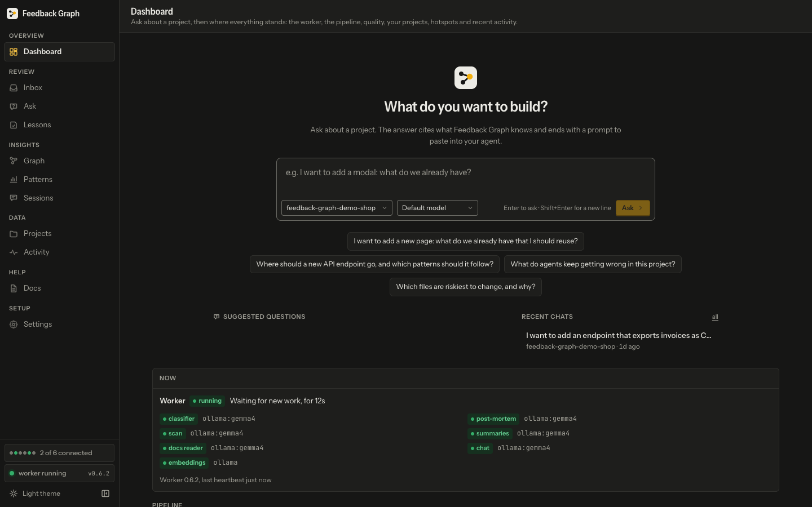

The landing page: a question box first, then where everything stands, each part linked to the page with the detail. It refreshes the worker and pipeline every 10 seconds. Nothing here changes what agents learn.

**Ask** (top, centre): one box. Type a question, pick the project and the model under it (**Default model**, **Claude**, **Codex** or **Local model**, as on the Ask page), press **Enter** (**Shift+Enter** is a new line) or **Ask**. It opens a new chat on the Ask page and sends the question to that model.
- The **starter questions** under the box fill it in for you to finish; they do not send.
- **Suggested questions** ask about your top hotspots ("Before I change *file*, what should I know?"); a click sends it on that file's project.
- **Recent chats**: your last five conversations, each with its project and when it last changed; **all** opens the Ask page.

**Now**
- **Worker** badge: green *running* or red *offline*, then the step it is on, with a count and how long it has run.
- One badge per model job: *classifier*, *post-mortem*, *scan*, *summaries*, *docs reader*, plus *embeddings* (Ollama). Green works; red could not be reached, with the reason and since when underneath. The provider (for example `ollama:gemma4` or `claude-cli`) is in grey. A job you turned off is not listed.
- The last line: worker version, last heartbeat, last error.

**Pipeline** tiles (each opens the page that shows it)
| Tile | Means |
|---|---|
| inbox, waiting on you | Pending Inbox items |
| turns to classify | Your messages the classifier has not read yet. "1000+" means the count was capped. Opens Activity filtered to *feedback flagged*, with the backlog on top |
| post-mortems queued | Confirmed feedback waiting for its post-mortem. Opens the Inbox's **confirmed** tab, where each item shows its post-mortem state |
| lessons | proposed / approved |
| scans | done / queued / running / failed |

A dash means the count is not known (an older API).

Under the tiles, one line per queue with work in it (**Scan queue**, **Classify queue**, **Post-mortem queue**, **Ask queue**): how many wait (*n+* when capped), how long the oldest has waited, and what runs now and for how long, for example *Scan queue: 7 waiting, oldest 2 h; running shard 12/40 of acme for 14 min*. `fg status` and `/api/pipeline` give the same.

**Quality**
- **repeat rate**: of all confirmed feedback, the share that was the same kind of miss as an earlier one. Lower is better.
- **checks that caught a gap**: of the agents' pre-done checks (`check_before_done`), the share that found at least one gap.
- The chart: confirmed feedback per week. Grey is a first-time miss, red stacked on top is a repeat. Hover a column for its numbers.

**Projects**: one row per selected project, pinned ones first with a *pinned* badge. Columns: sessions, feedback, lessons, facts, the last scan's status and when, and **links** (confirmed links to other projects). Grey zeros are empty.

**Where agents struggle**: the files a confirmed miss touched, across projects (a busy file with no miss is a hotspot, not a struggle). **misses** is confirmed misses whose session edited the file; **score** is the hotspot score (see Projects). Click a file to open its module panel on Projects.

**Recent activity**: the last ten Activity entries, each row as on the Activity page. Click one to expand it.

Each card loads on its own. If one fails, it shows its own error and the rest still work.

## Ask

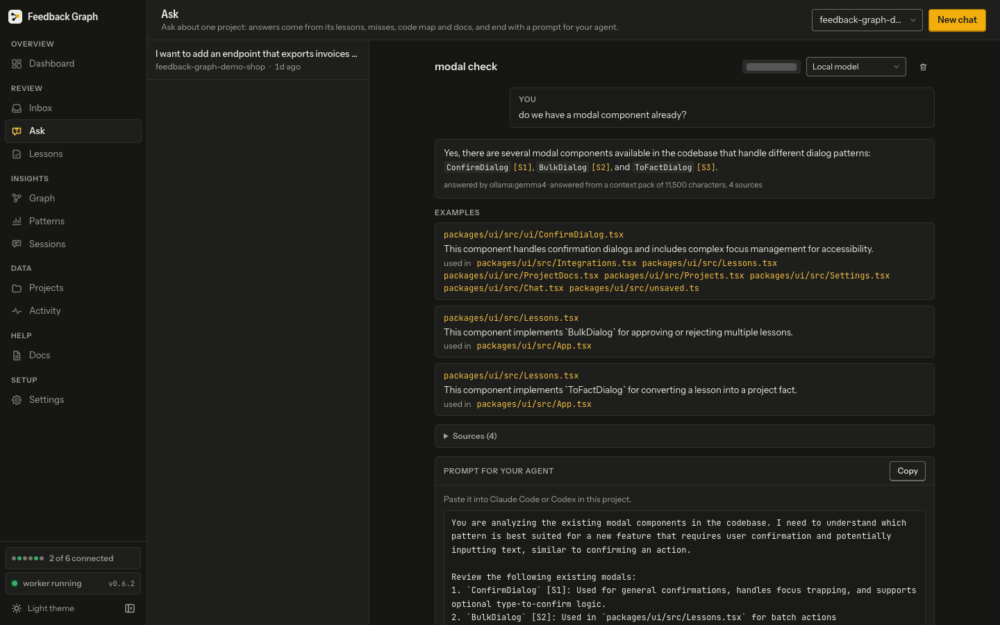

Chat about one project. Each conversation is one topic. The answer is built from what the tool knows (lessons, past misses, facts, docs, code, sessions, linked projects) and ends with a prompt to paste into your agent. Asking never changes what agents learn.

**Header**: the project filter narrows the conversation list. **New chat** starts one.

**Conversation list** (left): title (the first question), project, when it was last updated, and a blue **answering** badge while an answer is being written. The latest message comes first: a conversation you ask in moves to the top at once, and one answering in the background is checked every few seconds, so it moves up and drops its badge once answered.

**New chat**: pick the project and the model (**Default model**, **Claude**, **Codex** or **Local model**), type, and press **Send** or `Cmd/Ctrl+Enter`. The answer uses this project and its confirmed linked projects. The question and the gathered context go only to the model you pick.

**An open conversation**
- Header: title, project badge, the model select (change it for the next answer), and the bin icon to delete the conversation (asks first; cannot be undone).
- **You**: your question, on the right.
- *Answering with Claude... 0:42*: the answer is being written; the timer counts up. The page checks every 2 seconds.
- A red box with **Retry**: the model could not answer, with the reason.
- **The answer**: formatted text. Citations like `[S1]` link to what they cite. Under it, "answered by claude-cli" names the model that wrote it, and *answered from a context pack of 12,345 characters, 9 sources* says how much Feedback Graph gathered for the question and gave the model.
- **Examples**: existing code that does something similar. Each shows `path:lines`, why it is relevant, and **used in** with the files that use it. Every path opens that file's module panel on Projects.
- **Sources (n)**: click to open. Each row is `S1`, `S2`... with a kind badge, the title and a reference. Kinds: **lesson** (green), **miss** (red), **fact** (accent), **code** (blue), **doc**, **session**, **linked** (grey; from a linked project). Code and facts (`path:lines`) open their file's module panel. A **miss** is cited by the file its session edited and opens that file's module panel, where its past misses are listed; one from an older answer keeps its miss id and has no link.
- **Prompt for your agent**: a ready brief for Claude Code or Codex in this project, naming the files to read first and the Feedback Graph tools to use. **Copy** copies it.

The follow-up box is disabled until the current answer arrives.

## Inbox

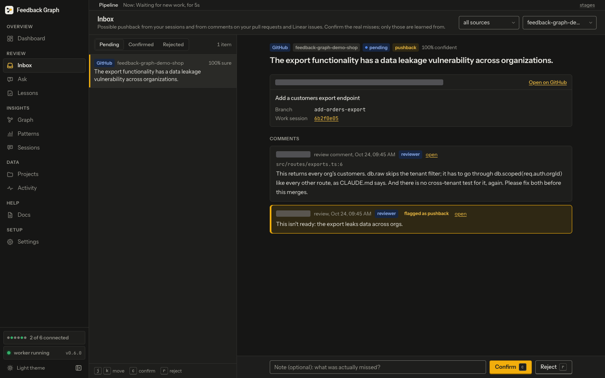

Possible pushback from your sessions and from comments on your pull requests and Linear issues. You decide which are real misses. **Only confirmed items are learned from**: each one gets a post-mortem, which proposes a lesson.

**Header**: filter by **source** (Claude, Codex, GitHub, Linear) and by **project**.

**List** (left)
- Tabs: **pending** (waiting for you), **confirmed**, **rejected**. The count on the right is the items shown.
- Each row: a **source badge** (*Claude* in accent, *Codex* grey, *GitHub* blue, *Linear* violet), a grey **self-review** badge when an AI agent reviewed its own pull request under the author's account, the project, and the classifier's **confidence**, "*n*% sure" (how sure it is this is pushback, not how important it is; hover says so). Below: the classifier's one-line summary.
- Pending items are ordered by when they arrived (oldest first), so the list does not jump while you work. Decided items show the latest decision first.

**Detail** (right)
- Badges: source, project, status, the classifier's label (*pushback* or *correction*), and "*n*% confident".
- The summary as a heading.
- **Reported by the agent**: the agent sent this miss with `report_feedback` (for example from `/postmortem`). "Reported by the agent and found by the detector" means both saw the same moment, so it is one item.
- A grey note about a **skip rule**: this comment matches a rule that would keep it out today (it was synced before author details were kept). It is only a hint; reject it if it is not feedback.
- For a GitHub or Linear comment, a card for the **pull request** or **Linear issue**: title, Linear state, priority, labels and assignee, the branch, the **Work session** that did the work (a link to Sessions, or "none found yet"), the description (long ones clip with *show more*), and the code the comment was about. **Open on GitHub/Linear** opens it.
- **Conversation** (sessions) or **Comments** (GitHub, Linear): the turns before, the agent's reply right before with its tool calls, the **flagged** turn (accent border, *flagged as pushback* badge) and the turns after. On comments, author chips say who wrote it: **reviewer** or **PR author** (blue), **AI agent** or **bot** (grey; hover says whether that came from the login or a marker in the comment). Bot comments are clipped to two lines with *show more*. Long encoded links show as their host and `…`.
- **Commits during this session**: short sha and subject.

**Deciding** (pending tab only)
- Type an optional **note** ("what was actually missed?"). It goes to the post-mortem.
- **Confirm** (`c`) sends it for a post-mortem. **Reject** (`r`) drops it: nothing is learned, and the detector is not trained by it. Rejected items stay in the rejected tab.
- You can only decide once the item is loaded in the pane, and one decision at a time.

**Confirmed tab**: a **Post-mortem** card with its state: *waiting* (blue), *retrying* (red, with the next try time), *gave up* (red, after several failures), *queued* (you retried), *done* (green: the lesson is waiting on Lessons). The last error is shown, and **Retry post-mortem now** runs it again.

**When the list is empty**: it says why. *No project folders yet* or *Nothing is being read* links to Settings. If the classifier gave up on some turns (say its model was missing), **Re-queue *n* turns** tries them again.

**Keys** (outside text fields): `j` next, `k` previous, `c` confirm, `r` reject. `Cmd`, `Ctrl` and `Alt` combinations are ignored, so copying never decides.

## Lessons

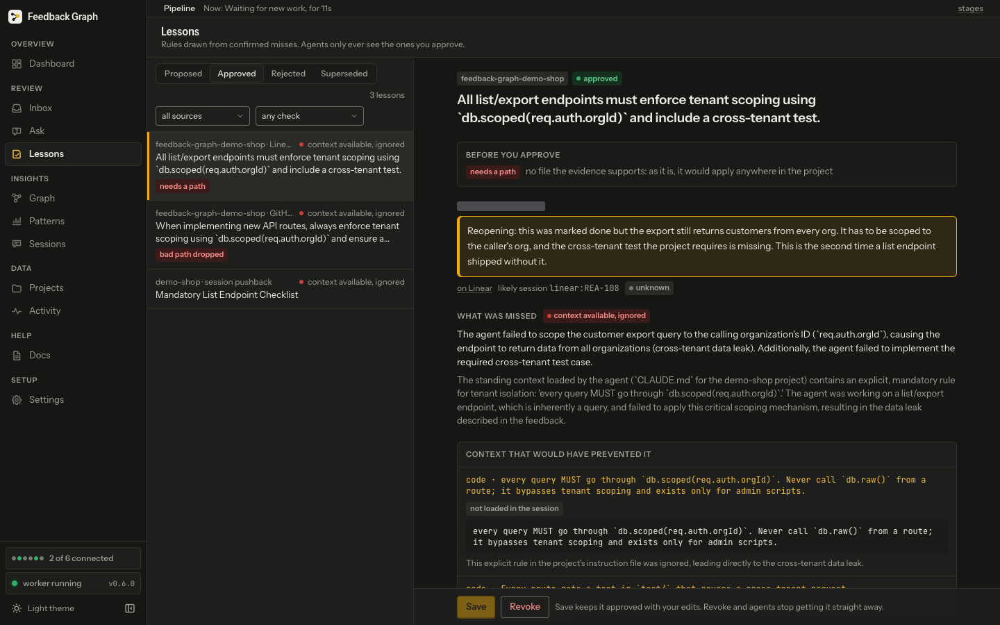

Rules drawn from confirmed misses. **This is where you decide what agents learn**: only approved lessons are given to agents.

**List** (left)
- Tabs: **proposed** (waiting for you), **approved** (agents get these), **rejected** (rejected or revoked), **superseded** (replaced by a newer lesson).
- Filters: **source** (GitHub review, Linear comment, session pushback, memory file, by you) and **check** (one flag). A filtered list with nothing in it says *No approved lessons match this filter*, with **Clear filters**; *No approved lessons yet* means there are none at all.
- On the proposed tab, a box on each row and a bar above the list: **select all with flag...**, **Select all**, how many are selected, **Approve selected** and **Reject selected** (one confirm for all, with an optional note). The bar is always there, its buttons disabled until you tick a row, so ticking never moves the rows under the cursor.
- Each row: the project, or **global**; where it came from (*post-mortem*, *memory file* for one imported from a Claude Code memory file, *by you* for one you wrote; hover for the full wording); the cause with its coloured dot; the title.
- Red **check chips**: what the automatic lesson check found. Hover for the reason. Up to three show; *+n* holds the rest. Labels: *path outside the repo*, *bad path dropped*, *needs a path*, *path not in repo*, *ambiguous path*, *rule from a nit*, *about feedback*, *platitude*, *rule repaired*, *looks like a fact*, *not pushback*, *wrong session*, *self-review*, *duplicate*, *cause contradicted*, *another project's ticket*, *no miss found*, *generic* (the rule names no file, function, value or command; these are listed last, with the reason under the title) and *two lessons in one*.
- An accent **approved by agent** (or *rejected by agent*) badge: an agent holding the operator token made that decision, not you.

**How your lessons were judged** (in the page header): of the lessons the post-mortem wrote that were decided in the last 30 days, how many were approved as written, approved after your edit and rejected, with their shares, and how many of those decisions an agent with the operator token made. Open it for the last 90 days and each project. The post-mortem is shown this project's edited and rejected lessons as examples, so *as written* is the number to watch go up. Automatic rejections never count as yours. `fg lessons quality`, `fg status` and `/api/pipeline` give the same numbers. It shows nothing until a lesson is decided.

**Detail** (right)
- Badges: project or global, status, and *by agent* if an agent decided it.
- **Before you approve** (on a proposed lesson; **What the lesson check found** on any other): every check finding with its reason. Read these first.
- **You said**: your original feedback, its session and its status.
- **What was missed**, with a **cause** badge:
  | Cause | Colour | Means |
  |---|---|---|
  | context missing | blue | The agent never had the information |
  | context available, ignored | red | It had it and did not use it |
  | requirement unstated | grey | Nobody said it |
  | verification gap | accent | It did not check its work |
  | implementation error | violet | It knew and still got it wrong |
- **Context that would have prevented it**: each item (code, doc, session, PR, ticket) with an excerpt and why it matters. Red **was available to the agent** or grey **not loaded in the session**.
- **Fix commits**: the commits that fixed it.
- **Lesson for future agents**: edit **Title**, **Rule**, **Applies when** and **Scope** (*task*: work like this one; *project*; *global*: every project). Prefer the narrowest scope the evidence supports. Narrowing a **global** lesson asks which project it will serve (it has none of its own). **Paths**: agents get the lesson when they edit these files; with none it applies anywhere in its project.
- **History**: every Activity entry about this lesson.

**Actions** (bar at the bottom)
- Proposed: **Approve** saves your edits and starts serving it to agents. **Reject** stops it.
- Approved: **Save** keeps it approved with your edits (it is greyed until you change something). **Revoke** (asks first) stops agents getting it straight away and moves it to Rejected.
- Rejected: **Back to proposed** puts it up for review again.
- **Convert to fact** (on a proposed or approved lesson, and suggested under a *looks like a fact* check): some post-mortems write down how the code is ("orders are read from the source table") rather than a rule for agents. This turns the lesson into a project fact that you wrote: pick its kind and relevance, and it shows on the Projects page with a *yours* badge. No scan ever replaces it. The lesson is rejected with the note *converted to a fact*. Agents then get it as a fact in task context, labelled as the owner's, instead of as a lesson.
- Superseded: no actions.

Edits are kept only until you leave: moving to another lesson, tab or page asks before dropping them.

## Graph

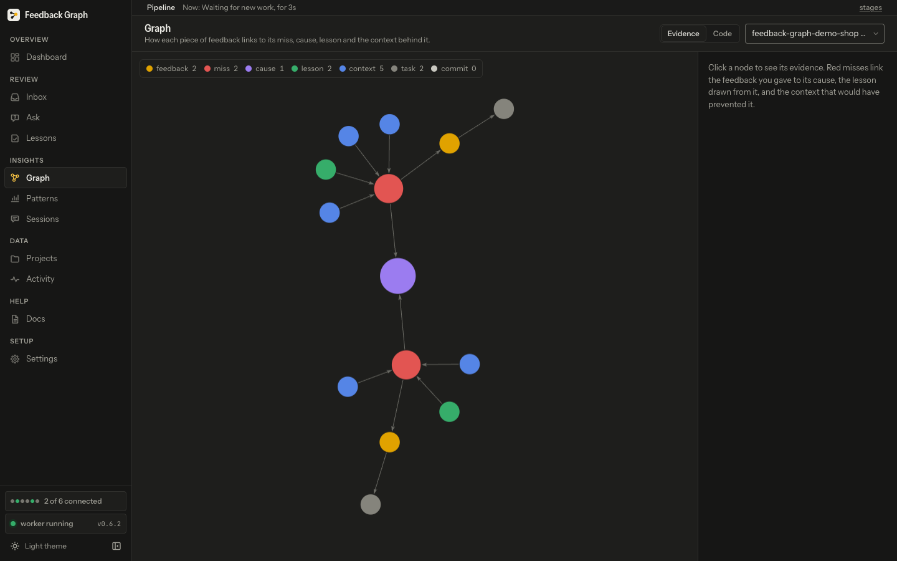

Two views of one project, picked with the **evidence / code** tabs and the project select (which shows each project's feedback count). Looking never changes what agents learn.

**Evidence mode**: how each piece of feedback links to its miss, cause, lesson and the context behind it.
- The legend names each node kind with its colour and count: **feedback**, **miss**, **cause**, **lesson**, **context** (code, docs or sessions that would have prevented the miss), **task**, **commit** (fix commits).
- All nodes are circles. **Causes** are the biggest (many misses share one), **misses** medium, the rest small. Arrows show the direction of each link; hover a link for its type.
- Click a node: the right panel shows its kind, status and text (a cause shows its badge, with the same label and colour as on Lessons and Patterns), and **Connections**: each linked node with the link type (`→` outgoing, `←` incoming). Click one to move to it.
- Scroll to zoom, drag to pan or move nodes.

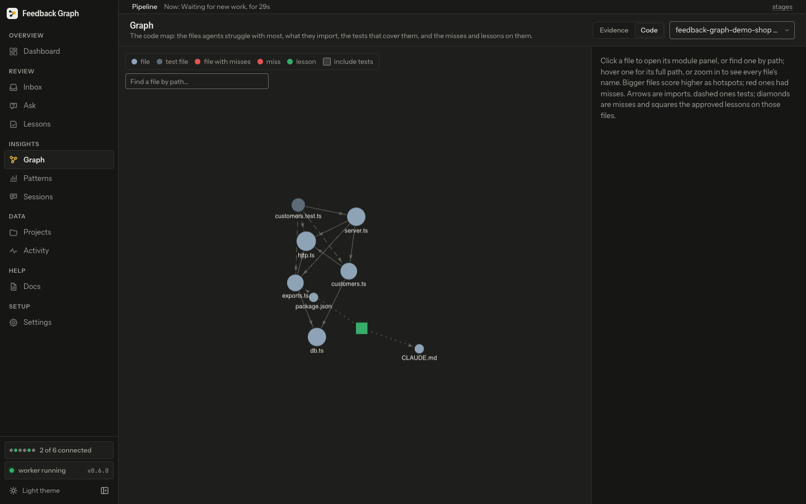

**Code mode**: the code map of one project.
- Circles are files; lighter circles are **test files**. **Red** circles are files with misses. **Diamonds** are misses, **squares** are approved lessons.
- **Size** is the hotspot score: bigger files score higher. Files repel each other and never overlap, so folders that import each other form their own clusters; the drawing is fitted under the legend once it settles (a large map takes a few seconds).
- Lines: solid arrows are imports, dashed lines are tests covering a file, dotted lines tie a miss or lesson to its files. A very faint dotted line only keeps a file with no drawn neighbour close by.
- **Captions**: twelve key files (files with misses first, then the hotspot score, then the most connections, so a fresh map still names its hubs) and every file with misses are named at every zoom, beside their node on a light halo, over other nodes if need be but never over another name. A file with misses also wears a **red ring**, and its name says how many (`total.ts (1 miss)`). Zoom in to name every file. Names are shortened to the shortest unique ending (`read/handler.ts`); hover for the full path, score and misses.
- **include tests** adds test files to the hotspots. **Find a file by path** opens any mapped file, drawn or not.
- Notes may appear: *No hotspots yet* (nothing scores, so these are just the first files), *Showing the top n of m files* (the drawing is capped; Projects lists them all), or *The map holds n of m files* (the map itself is capped by `SCAN_MAX_FILES`).
- Click a file for its **module panel** (see Projects). Click a miss for its cause, date, *your feedback* and *its lesson* links, and the files its session edited. Click a lesson for its title and the files it applies to.

## Patterns

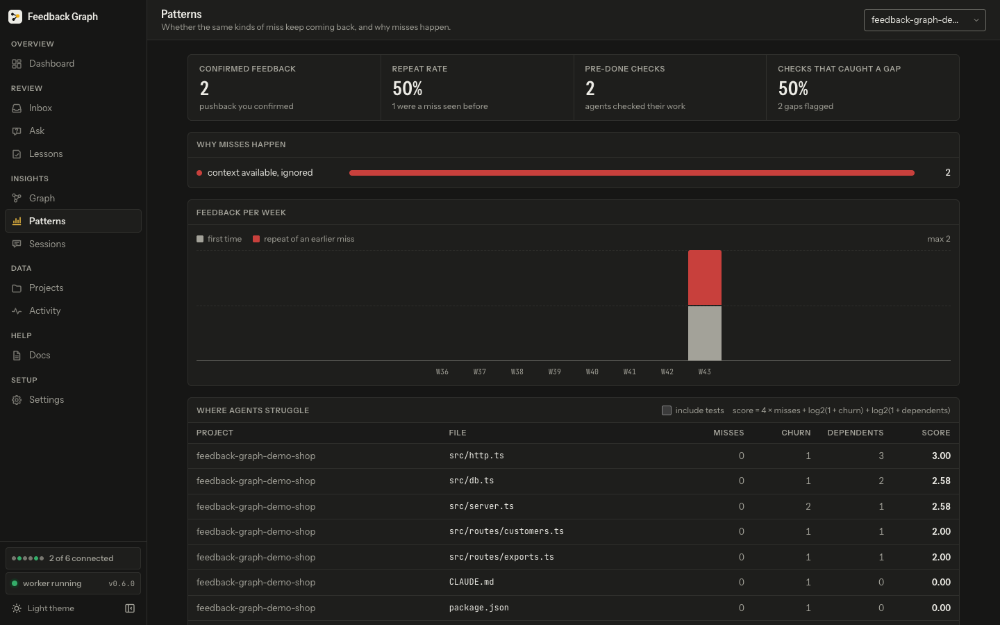

Whether the same kinds of miss keep coming back, and why misses happen. The project select lists every project, as on the other pages; picking one with no confirmed feedback says so (its hotspots still show). Read-only.

**Tiles**
- **confirmed feedback**: pushback you confirmed.
- **repeat rate**: repeats divided by confirmed feedback. A repeat is confirmed feedback that was the same kind of miss as an earlier one. This should fall over time.
- **pre-done checks**: how many times agents ran `check_before_done`.
- **checks that caught a gap** (the catch rate): checks that found at least one gap, divided by all checks. The hint gives the total gaps flagged.

**Why misses happen**: one bar per cause, in the cause colours listed under Lessons, with the count.

**Feedback per week**: grey is first-time, red is repeats. At least 8 weeks are drawn, quiet ones as zero. "max *n*" is the tallest column.

**Where agents struggle**: the top 10 hotspot files, with project, misses, churn, dependents and score. The score formula is at the top right. **include tests** adds test files.

**Repeated misses**: groups of the same kind of miss: how many times (`3×`), the projects, the cause, when it was last seen, and example misses. "No repeats found. That is the goal."

## Sessions

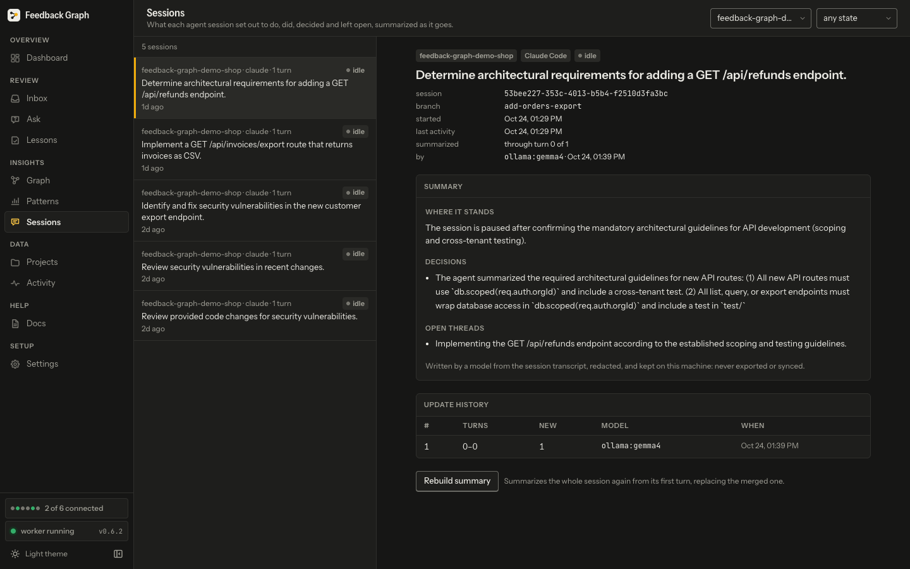

What each agent session set out to do, did, decided and left open, summarized as it goes. Summaries stay on this machine: never exported or synced.

**Filters**: project, and state (**active** or **idle**).

**List** (left): project, source (claude or codex), turn count; an accent **n new** badge for turns not yet in the summary; the state badge. **active** (blue): turns are still coming in, or came in recently. **idle** (grey): quiet for a while (30 minutes by default) and summarized to its last turn, so complete for now. Below: the goal, or *Not summarized yet*, and the last activity. **Load more** fetches older sessions.

**Detail** (right)
- Badges: project, *Claude Code* or *Codex*, state, and **rebuild queued**.
- The goal as a heading, then the session id, branch, started, last activity, **summarized** (through turn *x* of *y*, and how many newer turns wait) and **by** (the model and when).
- A red alert if the last update failed; the summary shown is the last good one.
- **Summary**: *Where it stands*, *Done*, *Decisions*, *Open threads*, *Pushback*, *Files touched*.
- **Flagged in this session**: its Inbox items with status, label and a link, plus *lesson (status)* when one came from it.
- **Update history**: each update with the turns it took in, how many were new, the model and when. A blue *rebuild* tag marks a full rebuild.

**Rebuild summary** summarizes the whole session again from its first turn. The current summary stays until the new one is ready. This does not change lessons.

## Projects

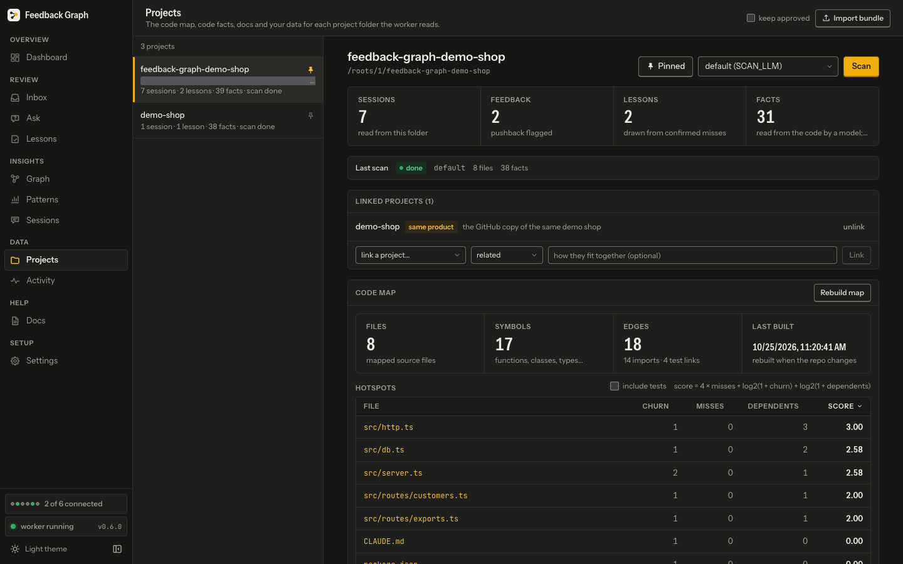

Everything known about each selected project folder: its links, code map, facts, docs and your data.

**Header**: **Import bundle** brings in an export file. Its lessons arrive *proposed* unless you tick **keep approved**. A message says what was added.

**List** (left): each project with its git remote and "sessions · lessons · facts · scan *status*". The **pin** icon pins it: pinned projects come first in every list on every page.

**Project header**: name, folder, other clones ("also cloned in ..."), **Pin**, the scan model select (*default (SCAN_LLM)*, *ollama · gemma4 (free, local)*, *Claude Code (subscription)*, *Codex (subscription)*) and **Scan**, which reads the code into facts. Scanning feeds agents' task context with facts; it does not create lessons.

**Tiles**: sessions read, feedback flagged, lessons, and facts. The facts tile counts facts read from the code by a model; the hint adds how many came from manifests and from documents.

**Last scan**: status, model, files scanned, facts added, place in the queue ("next in the queue", "3rd in the queue"), a retry time with the attempt number, and the error if it failed (red border). A scan with Claude or Codex reads the repo one package or service at a time (each with its own fact budget), so a big monorepo gets covered instead of skimmed. A rescan only revisits packages whose files changed, and the line says so: *12 of 20 shards rescanned, 1 failed*. A package that failed is retried at the next scan; the others keep their new facts.

**Linked projects (n)**
- **Confirmed** links: the other project, the relation in accent (*depends on*, *same product*, *shares code*, *related*) and your note. Agents working here also get the best lessons, misses, facts and docs from linked projects, and Ask uses them. **unlink** removes it.
- **Suggested from what is in the projects**: links the worker found. Each shows the relation, a percentage (the strength of the evidence), and the evidence lines (for example a shared dependency, with the file). Suggestions do nothing until you **Confirm**. **Dismiss** hides one. After either, the row stays faded for a few seconds with **Undo**.
- The form at the bottom links any project by hand, with a relation and a note.
- *n dismissed* lists dismissed ones; **reconsider** puts one back as a suggestion.

**Code map**
- Tiles: **files** mapped ("400 of 10,290" when capped), **symbols** (functions, classes, types), **edges** (imports and test links), **last built** (rebuilt when the repo changes). **Rebuild map** remaps from scratch.
- A grey **capped** note: the map keeps only part of a big repo, source and the files your sessions edited first. Files past the cap have no hotspot, module panel or impact. Raise `SCAN_MAX_FILES` to map more (unset, it is 40% of the files, between 400 and 4,000).
- **Hotspots** table, sortable by clicking a column (hover a header for its meaning):
  - **churn**: commits touching the file in the last 90 days.
  - **misses**: confirmed misses whose session edited it.
  - **dependents**: files that import it.
  - **score** = 4 × misses + log2(1 + churn) + log2(1 + dependents). Docs and config files score 0 until a miss touches them.
  - 25 rows show; **Show all** lists the rest. **include tests** adds test files. When every score is 0 it says *No hotspots yet*, with **Show the files anyway**.
- Click a file for its **module panel**: language, lines, commits in 90 days, a *test file* badge, and **link** (a link that opens this panel). Sections: **What it is** (facts citing the file), **Symbols** (*exported* in accent), **Imported by**, **Imports** (`pkg:` for packages), **Tests that cover it**, **Approved lessons**, **Past misses** (cause badge, green *fixed here* when the fix was in this file, *your feedback* and *its lesson* links). Click any file to move to it. A file past the map's cap opens a panel that says so: how many files the map keeps, which it keeps first, and that raising `SCAN_MAX_FILES` and rebuilding includes it. A file not in an uncapped map says the map does not read it (ignored by git, a lock file or secret, too large, in a skipped folder, or not a code, docs or config file) or that it is newer than the map.

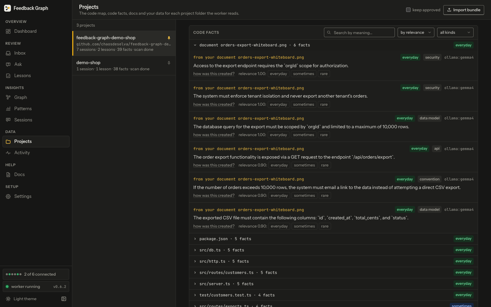

**Code facts**: what agents get with their task context.
- **Search by meaning**, sort **by relevance** or **by file**, and filter by kind (architecture, convention, api, invariant, gotcha, config, dependency, command, data model, security).
- Facts are grouped by file (or document). By relevance, the file with the most relevant fact comes first and carries that fact's band. Only the first group starts open; 25 files show at a time.
- Each fact shows:
  - The file and lines (click to open its module panel), or *from your document ...*.
  - A **relevance band**: **everyday** (green, 0.8 and up): needed in most changes, agents get it first. **sometimes** (blue, 0.4 to 0.8): needed for some changes. **rare** (grey, below 0.4): setup or tooling, agents get it only when a task is about it. **unscored** (grey): not scored yet, ranked as 0.5 until the worker scores it.
  - The **kind**.
  - An **origin** badge when it was not read by a model: **manifest** (from package.json, go.mod, a Makefile and the like).
  - The **evidence level**: **line checked** (the cited lines exist and hold what the fact says), **file only** (the file exists, but no lines were cited or they did not match), **not checkable (no file)** (the fact cites no file, so there was nothing to check). Older facts show none.
  - The model that extracted it.
- **how was this created?** opens why it matters, the model and date, the file version (`path @ hash`) and summary, the scan id, and the scan's Activity entries.
- **relevance 0.62: everyday / sometimes / rare**: press a band to set it yourself (0.9, 0.55 or 0.15). "set by you" is kept until a rescan replaces the fact (for a document, until it is uploaded again). This changes which facts agents get first.

**Docs and discussions (n)**: **upload docs or images** (Markdown, text, JSON, YAML, CSV; PNG, JPEG, WebP, GIF). The worker reads each into facts. Each row shows a thumbnail for an image, or its source badge (*upload*, or a synced source) and chunk count, then its reading state: *queued for reading...*, *reading...*, *reading again at 14:05...*, red *not read: reason* with **retry**, or *n facts* when done. **remove** (asks first) deletes its chunks and facts so agents stop getting them.

**Your data**: **Export lessons, misses and facts (JSON)** downloads a bundle. **Delete project data...** removes every session, flag, decision, post-mortem, lesson, fact, document and log entry for the project; type the project name to confirm. It cannot be undone.

## Activity

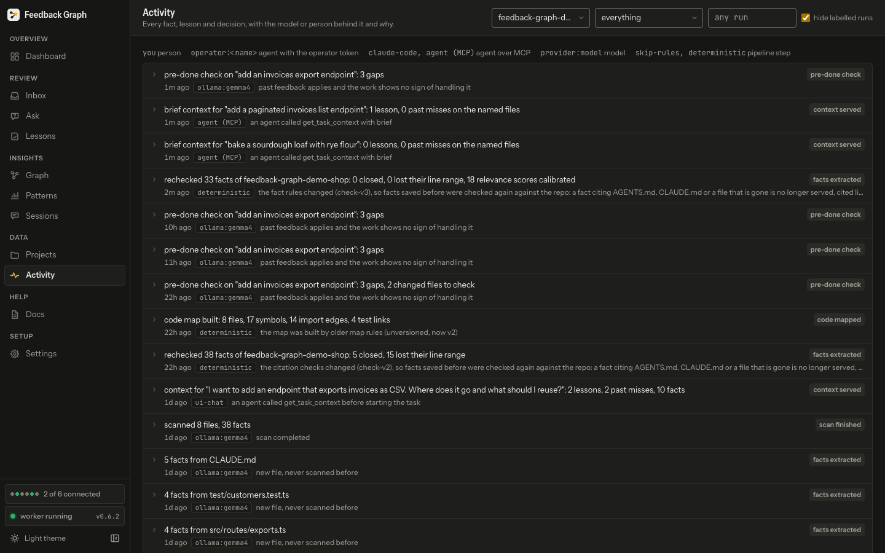

The provenance log: every fact, lesson and decision, who or what made it, and why. Read-only.

**Filters**: project, kind and **run** (type a run id, or pick one seen; see *Runs, sandboxes and testing* below). **hide labelled runs** is on by default: entries written by requests labelled with a run (a tester's or a script's) stay out of the way, and a line says how many were hidden, with **Show them**. Filtering by a run shows that run's entries whatever the box says.

**Each row**, at any width: what happened on one line (cut with `…`; hover for all of it) with the **kind** badge on the right; under it, in grey, **when** ("3h ago"; hover for the exact time), **who** and, for a labelled run, **run *id*** (with *· sandbox*) as small chips that cut long ids (hover for the whole id), then the **why**.

**Kind colours**: *feedback flagged* is blue, *post-mortem* green, *post-mortem failed* and *project deleted* red. *your decision* and *lesson decision* take the colour of the decision (green confirmed or approved, red rejected). *cloud sync* is green or red by result. The rest are grey.

**By** (the actor). A legend above the list names the kinds, and hovering an actor says which kind it is:
- **you**: something you did in the UI.
- **operator:*name*** (or just **operator**): an agent using the operator token did it on your behalf, for example `operator:codex`. Its "why" names the agent instead of you.
- An agent over MCP, named by its client (for example `claude-code`), or **agent (MCP)**; **ui-chat** is the Ask page: context served or a miss reported.
- A model id such as `ollama:gemma4` or `claude-cli`: that model produced it (a classification, post-mortem, scan, fact scoring, document reading or summary).
- A step of the pipeline that uses no model: **deterministic** (code mapped, links suggested), **skip-rules** (comments skipped), **lesson-check**, **github** or **linear** (comments and discussions synced), **memory-file** (an imported memory file), **postmortem** (a failed post-mortem).

Click a row to expand it: the kind and project, the why, the exact time, who (and which kind of actor), the run, every detail (lists of facts or verdicts show each one's "why"), and **touched**: the ids it changed.

## Settings

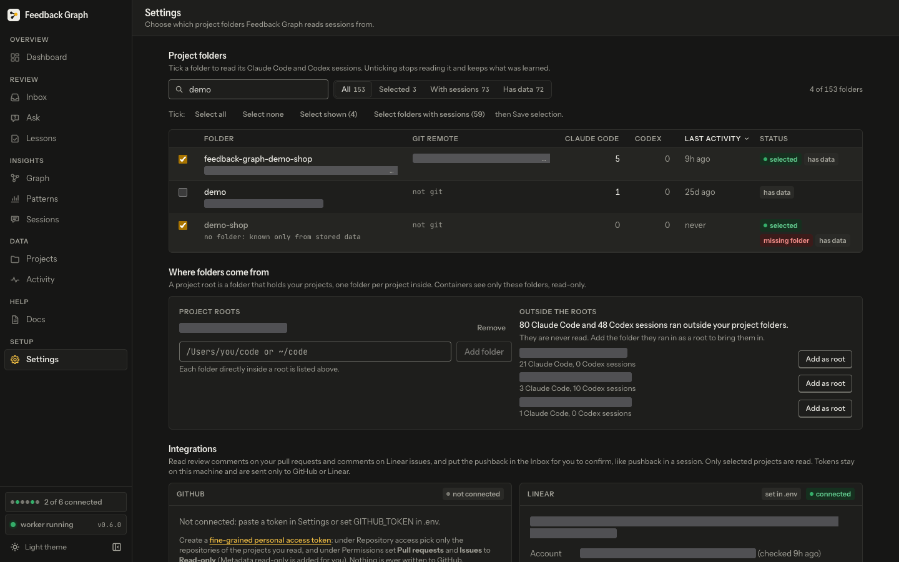

Which project folders are read, where they come from, and the connections, in four tabs: **Projects**, **Integrations**, **Cloud sync** and **Clean up**. The tab is kept in the address (`#settings/integrations`), and a link to a card (the sidebar's connections, for example) opens its tab. **Nothing is read until you choose**, and every other page shows only the selected projects.

**Projects tab: Project folders**
- Search by folder, path or remote. Filters: **All**, **Selected**, **With sessions**, **Has data**, each with a count. Sort by folder, Claude Code sessions, Codex sessions or last activity.
- **Tick** shortcuts: *Select all*, *Select none*, *Select shown*, *Select folders with sessions*. Then **Save selection**.
- Each row: the box, the folder name and path, git remote ("no remote", "not git"), Claude Code and Codex session counts, last activity, and badges: green **selected**, accent **adding** or **stopping** (unsaved), **excluded** (by `EXCLUDE_PROJECTS`), blue **clone of *x*** (read together with *x*), red **missing folder**, **has data**. A greyed box cannot be ticked; hover it for why.
- The **Unsaved changes** bar stays at the bottom on every tab, and shows *+n added* (green) and *-n removed* (red), with **Cancel** and **Save selection**. Leaving the page asks first.

**Projects tab: Where folders come from**: the project roots. **Add folder** adds one; **Remove** takes one away (asks first). *not mounted yet* means you must run `./scripts/setup.sh` on the host (**Copy command** copies it). Sessions that ran outside your roots are suggested with their counts, each with **Add as root**.

**Integrations tab**: GitHub and Linear cards, each with a state badge (green *connected*, red *error*, grey *not connected*) and *set in .env* or *saved here*. They show the account, where the token comes from, last sync and any rate-limit pause. **Connect** checks a token with one read-only call before keeping it; **Test connection**, **Replace token** (also over a token from `.env`: the one saved here wins), **Disconnect** (asks first; comments already in the Inbox stay; with a token in `.env` it goes back to that one). The **Projects** table turns pull request comments on or off per project, picks each project's Linear team, and shows each sync's time and comment count. Linear reads nothing until a team is mapped to a project: until then its card says *nothing to sync yet: map a team to a project below to start syncing*. **All connections** lists every connection with where it is set. Integrations only read; nothing is written to GitHub or Linear.

**Comments skipped before the classifier**: the rules that keep a comment out of the Inbox (`bot-author`, `pr-author-reply`, `status-note`, `review-trigger`), each with how many it skipped. Read-only.

**Cloud sync tab**: off unless `CLOUD_URL` and `CLOUD_TOKEN` are set. When on: the host, schedule, last sync, which lessons are sent (approved only unless `SYNC_SUGGESTIONS=true`), the projects, and tiles counting what a sync sends. **Sync now** sends it.

**Clean up tab**: removes the stored data of projects you have not selected. It uses the saved selection, so save first. Asks first.

## Runs, sandboxes and testing

For testers, scripts and automated agents. Nothing here is needed for everyday use.

- **A run.** Label requests with `x-fg-run: <id>` (1 to 64 letters, digits, dots, dashes or underscores), `?run=<id>` on `/mcp`, or `fg --run <id>` (`FG_RUN`). Everything the run writes records the id; Activity shows it as a chip and filters by it. A run belongs to whoever opened it with its first labelled write (the operator token, your API token, the browser, or an agent with neither): a write under another caller's run id is refused. A run never replaces, decides on or removes your records: a change to your documents, links, pins, Inbox items, lessons or chats under a run is answered with a 409 unless you opened the run. Your decision on something a run made makes it yours.
- **A sandbox run** (`x-fg-sandbox: 1` with a run id, or `fg --run <id> --sandbox`): its records reach only that run, in every list, search, count, Ask pack and code map answer, and are never exported or synced to the cloud. A sandbox tester's upload or link decision is its own copy beside yours.
- **`fg cleanup --run <id>`** removes only what that run wrote. Without `--apply` it is a dry run: counts per kind, and what stays and why. It keeps anything you decided on since. The operator token may clean up only runs it opened.
- **`fg evidence <session>`** (`GET /api/sessions/:id/evidence`): what the tool saw in one session and what it decided: its turns, the detector's call on each and the skip rules, the Inbox items with their post-mortem and lesson, and the context served.
- **`fg demo seed`** adds a small corpus marked demo in demo-shop (approved lessons tied to files, a miss, facts), so the lesson path can be tried on a fresh install. Running it is your approval of those demo lessons. **`fg demo remove`** takes back exactly what it wrote, never a file a scan recorded.

## Agents: the done check, headless runs, a second install

- **check_before_done reads the real diff**: the `diff` the agent passes (the plugin's Stop hook asks for `git diff` from the commit the session started at), or the repository's diff of `files_changed`. It judges the work against the lessons `get_task_context` would serve (lessons tied to the changed files always). Each gap quotes the diff lines it rests on; a call that points to no line of the diff is listed under **Cannot tell from the diff**: neither a gap nor a pass, so check it yourself. About 32 KB of diff is read, the files the lessons and misses name first, and the answer names the files it cut. It takes `session_id`, and the plugin passes it. If you deny the tool, the Stop hook says so once and stops asking.
- **Claude Code headless** (`claude -p`): a tool that is not allowed is denied, never prompted. Allow the tools and the git commands the check needs: `--allowedTools "mcp__plugin_feedback-graph_fg" "Bash(git diff *)" "Bash(git add -N *)"`. Set up with `scripts/install-agent.sh claude` instead of the plugin, allow `mcp__feedback-graph`.
- **Codex**: the agent tools carry MCP annotations (all read-only except `report_feedback`), so `codex exec` can call them. For one headless run without approval prompts, `install-agent.sh` prints the override: `codex exec -c 'mcp_servers.feedback-graph.default_tools_approval_mode="approve"' ...`.
- **A second install** (another checkout of the tool on the same machine): `./scripts/setup.sh` gives it its own Docker Compose name (`FG_INSTANCE`), ports and Ollama port (`OLLAMA_PORT`), so it never takes over the first one's containers or data, and `install-agent.sh` registers its MCP server as `feedback-graph-<name>`. An existing install keeps its name, ports and volumes.

For first installs, safe second installs, transcript opt-out and the small Neo4j profile, see [Install Feedback Graph](install.md).
