# Using Feedback Graph, page by page

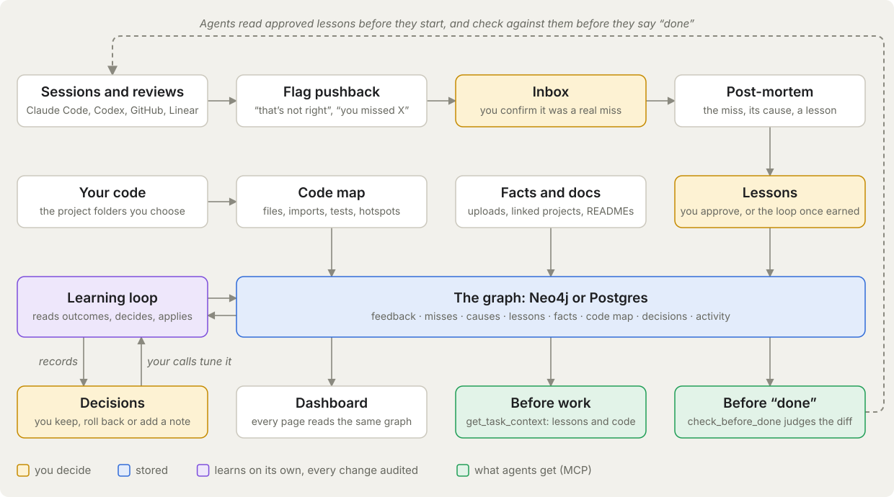

This guide says how to read every page of the UI: what each region, badge, number and colour means, what each button does, and whether it changes what your agents learn.

One rule runs through all of it: **agents only ever get approved lessons**. Confirming feedback, scanning code and uploading docs feed the pipeline, but nothing becomes a lesson for agents until it is approved: by you, with **Approve** on the Lessons page, or by the learning loop. The loop runs in `auto` by default, and in `auto` its `approve_lesson` decision may approve a proposed lesson on its own (never one learned from a GitHub or Linear comment), but only once your own verdicts on its proposals have earned it, counted per confidence band (at least 20 in the call's band, with that band's lower bound at τ 0.9 or above), and at most 5 agent-facing changes a day, 2 per project. Until then it proposes and you decide. Every lesson it approves is on the [Decisions](#decisions) page and can be rolled back. To keep every approval yours, set the mode to *propose* in Settings > Learning loop (or `fg loop mode propose`).

Colours mean the same thing on every page:

| Colour | Means |
|---|---|
| Blue | Waiting: pending, proposed, queued, running, answering |
| Green | Done or kept: confirmed, approved, done, connected |
| Red | Refused or failed: rejected, failed, revoked, error |
| Grey | Neutral, or retired (superseded, idle, off) |
| Accent (the brand colour) | Highlights: pinned, flagged as pushback, decided by an agent |
| Violet | One more distinct colour where a set needs it (a cause, the *Linear* source); never a status |

Times like "5m ago" show the exact time, in words, when you hover them.

A value this release does not know (a kind, source, check or state stored by another release) shows as stored instead of breaking the page.

An owner action (**Approve**, **Scan**, **Pin**, **Retry** and the like) says what it is doing while its request runs ("Approving…") and ignores a second press. A box that scrolls (a table, a code block, a list or pane) takes keyboard focus while it overflows and holds nothing else to focus, so `Tab` reaches it and the arrow keys scroll it.

## A typical session

1. **First run.** Open the UI. If it asks you to sign in, see [Signing in](#signing-in). If a blue bar says *No projects are selected*, go to **Settings**. If Settings lists no folders, add the folder that holds your projects under *Where folders come from*, then run `./scripts/setup.sh` on the host.
2. **Select projects.** In Settings, tick the project folders to read and press **Save selection**. Check the sidebar badge says **worker running**.
3. **Triage the Inbox.** Open **Inbox**. Read each pending item and press `c` to confirm real pushback or `r` to reject anything else. `j` and `k` move. Each confirmed item gets a post-mortem.
4. **Approve lessons.** A few minutes later open **Lessons**, tab *proposed*. Read the evidence, fix the wording or narrow the scope, and press **Approve** or **Reject**. Approved lessons reach your agents straight away.
5. **Ask.** Open **Ask**, start a **New chat** on a project and ask "I want to add X: what do we already have?". Copy the *Prompt for your agent* into Claude Code or Codex.
6. **Check the Dashboard.** Watch the pipeline counts, the repeat rate and the hotspots. A falling repeat rate means lessons are working.

### Signing in

On an install with an owner token (`FG_OWNER_TOKEN`), the UI first shows a **Sign in** card. In the install folder, run `./scripts/fg signin` and open the link it prints: it signs this browser in once, within 60 seconds. Pasting `FG_OWNER_TOKEN` from `.env` is the fallback; the agent `API_TOKEN` does not work here. An upgraded install with an API token but no owner token shows **Owner sign-in needs setup** instead: run `./scripts/setup.sh --yes`, restart the API, then reload the page.

A read-only install (one with no tokens) needs no sign-in, but you cannot make owner decisions from it: see the **Read-only** bar below.

## The sidebar

Pages are grouped: **Overview** (Dashboard), **Review** (Inbox, Intake when knowledge intake is on, Ask, Lessons, Decisions), **Insights** (Learning loop, Graph, Patterns, Sessions), **Data** (Projects, Activity), **Help** (Docs) and **Setup** (Settings). The highlighted entry is the page you are on. A count beside **Decisions** is how many of the learning loop's proposals wait for you (in the tooltip when the sidebar is collapsed).

At the bottom:

- **Connections**: one dot per connection (GitHub, Linear, Claude, Codex, Ollama, Cloud sync). Green is connected, red is an error, grey is not connected. The label says "3 of 6 connected", or names the one with a problem (the button turns red). Click it for each connection's state, the reason, and whether it was set in `.env` or in the app; each row links to where it is managed.
- **Health badge**: a green dot and **worker running** when all is well. Red with a reason otherwise: **worker offline**, **graph unreachable**, **no projects selected**, **no project folders**, **Ollama unreachable**, **Ollama model missing**, **classifier unavailable** (or post-mortem model, scan model, docs reader, Ask model), or **summaries paused**. Hover it for the details: what the worker is doing now, the last heartbeat and the last error. A Codex runner turned off on purpose by its safety flag is not an error: a grey dot and **Codex runner off: scans paused** (naming the jobs that wait), linking to Settings, with the reason and the fix on hover; Codex then shows as not connected rather than red.
- **Sign out** (when you signed in) ends this browser's owner session.
- **Dark theme / Light theme** switches the theme; the version is beside it. The arrow button collapses the sidebar to icons (remembered in this browser).

On a phone the sidebar folds into a top bar: the menu button opens it, `Esc` closes it.

Bars that can appear above any page:

- **Read-only** (accent): the install has no owner token, so Inbox decisions, lesson edits, scans, Ask and settings are turned off. Run `./scripts/setup.sh --yes --enable-auth` in the install folder, then sign in with `FG_OWNER_TOKEN`. Until then every owner control is disabled; hover one for the reason. An open tab notices when the install gains or loses its tokens, without a reload.
- **No projects are selected** (blue): nothing is read until you choose in Settings.
- **Pipeline** (on Inbox, Lessons and Graph): one line with what the worker is on now (*Now: Classifying turns: 3 of 50, for 2m 10s*) and the backlog. Press **stages** for every stage: **Sessions read**, **Turns to classify**, **Inbox, waiting on you**, **Post-mortems queued**, **Lessons** and **Project scans**, each linking to the page that shows it (turns to classify opens Activity filtered to *feedback flagged*; post-mortems queued opens the Inbox's confirmed tab). While the page has nothing to show, one line above says where it stands: *Nothing in the Inbox yet* (*Nothing waiting for you in the Inbox* once you have confirmed something), *No lessons yet* or *No evidence chains yet*. Until a lesson is approved it also points to **Getting started** on the Dashboard. A screen reader hears the step when it changes, not its count and time on every refresh.
- **Reconnecting to the API** (blue): a change you made is being retried. If it gives up, a red alert says so, so a decision is never lost silently.

## Dashboard

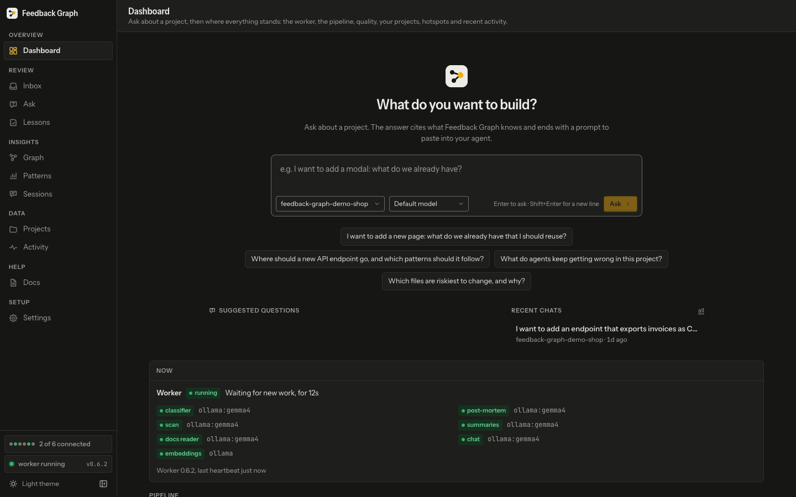

The landing page: a question box first, then where everything stands, each part linked to the page with the detail. It refreshes the worker and pipeline every 10 seconds. Nothing here changes what agents learn. If the API is down, one alert says so and each card waits for it to answer.

**Getting started** (above the box, until every step is done): four steps from a fresh install to the first lesson your agent gets, each ticked off by what the API reports: **choose the projects to learn from** (Settings), **connect your agent** (run `./scripts/install-agent.sh` from the folder you cloned, with a copy button; done once your agent's MCP client first calls a tool, which `fg demo context` and `fg demo check` do not count as), **confirm a miss** (in the Inbox, or tell your agent "record a miss: …") and **approve your first lesson**. Lessons `fg demo seed` wrote tick neither of the last two. Only the next step is spelled out, so the list stays short on a phone.

**Ask** (top, centre): one box. Type a question, pick the project and the model under it (**Default model**, **Claude**, **Codex** or **Local model**, as on the Ask page), press **Enter** (**Shift+Enter** is a new line) or **Ask**. It opens a new chat on the Ask page and sends the question to that model. On a read-only install the box, the starter questions and the suggested questions are disabled.
- The **starter questions** under the box fill it in for you to finish; they do not send.
- **Suggested questions** ask about your top hotspots ("Before I change *file*, what should I know?"); a click sends it on that file's project.
- **Recent chats**: your last five conversations, each with its project and when it last changed; **all** opens the Ask page.

**Now**
- **Worker** badge: green *running* or red *offline*, then the step it is on, with a count and how long it has run.
- One badge per model job: *classifier*, *post-mortem*, *scan*, *summaries*, *docs reader*, *chat* (Ask), plus *embeddings* (Ollama). Green works; red could not be reached, with the reason and since when underneath. The provider (for example `ollama:gemma4` or `claude-cli`) is in grey. A job you turned off is not listed.
- The last line: worker version, last heartbeat, last error.

**Pipeline** tiles (each opens the page that shows it)
| Tile | Means |
|---|---|
| inbox, waiting on you | Pending Inbox items |
| turns to classify | Your messages the classifier has not read yet. "1000+" means the count was capped. Opens Activity filtered to *feedback flagged*, with the backlog on top |
| post-mortems queued | Confirmed feedback waiting for its post-mortem. Opens the Inbox's **confirmed** tab, where each item shows its post-mortem state |
| lessons | proposed / approved |
| scans | done / queued / running / failed |

A dash means the count is not known (an older API).

Under the tiles, one line per queue with work in it (**Scan queue**, **Classify queue**, **Post-mortem queue**, **Ask queue**): how many wait (*n+* when capped), how long the oldest has waited, and what runs now and for how long, for example *Scan queue: 7 waiting, oldest 2 h; running shard 12/40 of acme for 14 min*. `fg status` and `/api/pipeline` give the same.

**Quality**
- **repeat rate**: of all confirmed feedback, the share that was the same kind of miss as an earlier one. Lower is better.
- **checks that caught a gap**: of the agents' pre-done checks (`check_before_done`), the share that found at least one gap.
- The chart: confirmed feedback per week. Grey is a first-time miss, red stacked on top is a repeat. Hover a column for its numbers.

**Learning loop** (under Pipeline): the mode it runs in (and the one set, when a pause, `LOOP_DISABLED` or a tokenless install holds it lower), this week's applied, proposed and rolled-back decisions, how many proposals wait (a link to Decisions), the rollback rate, the model calls spent today, and **Pause learning** / **Resume learning**. **Watch it** opens the Learning loop page. An API without the loop shows no card.

**Learning-loop metrics** (under Learning loop), over the last weeks (8, from the week it names):
- **Gaps fixed per serving**: gaps fixed per time a lesson was served. **Not applicable**: the share of the done check's verdicts that said a lesson did not apply. Each shows the share, *k of n* and its 95% interval, which says more than the share while *n* is small.
- **Proposals per week**: the decisions that waited for you, a column per week (hover one for its count). It stands in for the time the loop costs you.
- **Rolled back, by type**: of each type's decisions applied in the window, how many were rolled back, with the interval.
- The repeat rate and the checks that caught a gap are under **Quality**, so they are not shown twice. Before anything is measured the card says *Nothing measured yet*; an API without metrics shows no card.

**Projects**: one row per selected project, pinned ones first with a *pinned* badge. Columns: sessions, feedback, lessons, facts, the last scan's status and when, and **links** (confirmed links to other projects). Grey zeros are empty. The first ten show; **Show all *n*** lists the rest. A line under the table counts the global lessons, which serve every project and are in no row.

**Where agents struggle**: up to eight files a confirmed miss touched, across projects (a busy file with no miss is a hotspot, not a struggle). **misses** is confirmed misses whose session edited the file; **score** is the hotspot score (see Projects). Click a file to open its module panel on Projects.

**Recent activity**: the last ten Activity entries, each row as on the Activity page. Click one to expand it.

Each card loads on its own. If one fails, it shows its own error and the rest still work.

## Ask

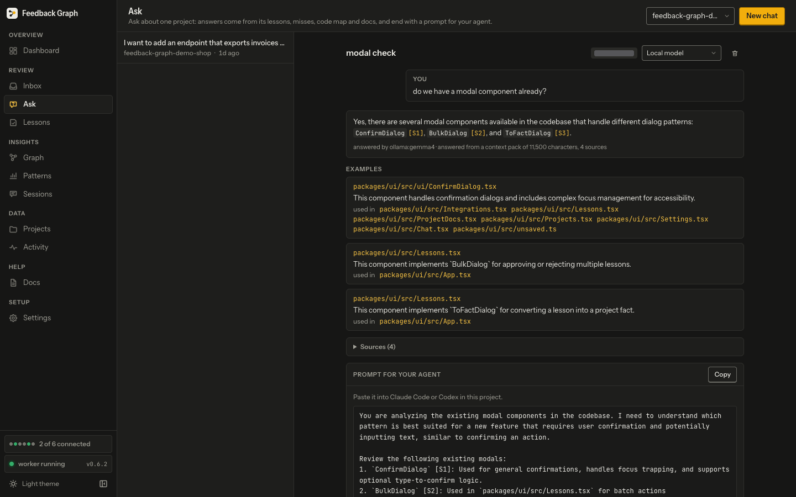

Chat about one project. Each conversation is one topic. The answer is built from what the tool knows (lessons, past misses, facts, docs, code, sessions, linked projects) and ends with a prompt to paste into your agent. Its approved lessons are those `get_task_context` serves for the files the question names, those whose path triggers fire on a folder it names, and those closest to it by meaning, as `search_graph` finds them. Asking never changes what agents learn.

**Header**: the project filter narrows the conversation list. **New chat** starts one. The page opens on a new chat (with the project and model to pick), not on your last conversation, unless a link names one.

**Conversation list** (left): tick conversations and press **Delete ticked** to delete several at once (asks first; cannot be undone). Each row: title (the first question), project, when it was last updated, and a blue **answering** badge while an answer is being written. The latest message comes first: a conversation you ask in moves to the top at once, and one answering in the background is checked every few seconds, so it moves up and drops its badge once answered.

**New chat**: pick the project and the model (**Default model**, **Claude**, **Codex** or **Local model**), type, and press **Send** or `Cmd/Ctrl+Enter`. The answer uses this project and its confirmed linked projects. The question and the gathered context go only to the model you pick.

**An open conversation**
- Header: title, project badge, the model select (change it for the next answer), and the bin icon to delete the conversation (asks first; cannot be undone).
- **You**: your question, on the right.
- *Answering with Claude… 0:42*: the answer is being written; the timer counts up. *Waiting for Claude: 2 questions ahead of this one…* means that model is answering other questions first. The page checks every 2 seconds.
- A red box, *Claude could not answer: reason*, with **Retry**.
- **The answer**: formatted text. Citations like `[S1]` link to what they cite. Under it, "answered by claude-cli" names the model that wrote it, and *answered from a context pack of 12,345 characters, 9 sources* says how much Feedback Graph gathered for the question and gave the model.
- **Examples**: existing code that does something similar. Each shows `path:lines`, why it is relevant, and **used in** with the files that use it. Every path opens that file's module panel on Projects.
- **Sources (n)**: click to open. Each row is `S1`, `S2`... with a kind badge, the title and a reference. Kinds: **lesson** (green), **miss** (red), **fact** (accent), **code** (blue), **doc**, **session**, **linked** (grey; from a linked project). Code and facts (`path:lines`) open their file's module panel. A **miss** is cited by the file its session edited and opens that file's module panel, where its past misses are listed; one from an older answer keeps its miss id and has no link.
- **Prompt for your agent**: a ready brief for Claude Code or Codex in this project, naming the files to read first and the Feedback Graph tools to use. **Copy** copies it.

The follow-up box is disabled until the current answer arrives.

## Inbox

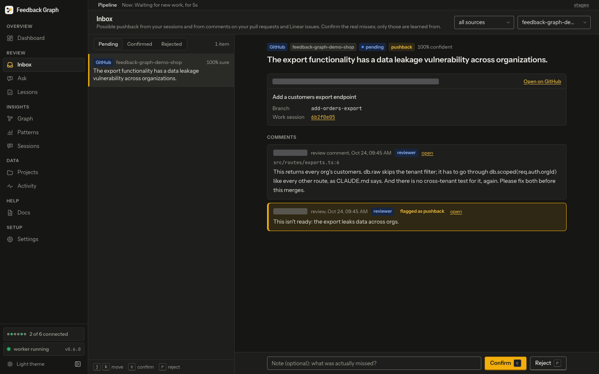

Possible pushback from your sessions and from comments on your pull requests and Linear issues. You decide which are real misses. **Only confirmed items are learned from**: each one gets a post-mortem, which proposes a lesson.

**Header**: filter by **PR number**, **Feedback author** (an exact GitHub or Linear login), **source** (Claude, Codex, GitHub, Linear) and **project**. A filter that matches nothing says *No feedback matches these filters*, with **Clear filters**.

**List** (left)
- Tabs: **pending** (waiting for you), **confirmed**, **rejected**. The count on the right is the items shown (*more waiting* when there are more); **Load more**, at the end of the list, adds the next page.
- Each row: a **source badge** (*Claude* in accent, *Codex* grey, *GitHub* blue, *Linear* violet), a grey **self-review** badge when an AI agent reviewed its own pull request under the author's account, a grey **PR never merged** badge on a comment whose pull request was closed without merging, the project, and the classifier's **confidence**, "*n*% sure" (how sure it is this is pushback, not how important it is; hover says so). A miss your agent reported that the classifier never scored says *agent report* instead. Below: the classifier's one-line summary.
- Pending items are ordered by when they arrived (oldest first), so the list does not jump while you work. Decided items show the latest decision first.

**Detail** (right)
- Badges: source, project, status, the classifier's label (*pushback* or *correction*), and "*n*% confident".
- The summary as a heading.
- **Reported by the agent**: the agent sent this miss with `report_feedback` (for example from `/postmortem`). "Reported by the agent and found by the detector" means both saw the same moment, so it is one item.
- A grey note about a **skip rule**: this comment matches a rule that would keep it out today (it was synced before author details were kept). It is only a hint; reject it if it is not feedback.
- For a GitHub or Linear comment, a card for the **pull request** or **Linear issue**: title, Linear state, priority, labels and assignee, the branch, the **Work session** that did the work (a link to Sessions, or "none found yet"), the description (long ones clip with *show more*), and the code the comment was about. **Open on GitHub/Linear** opens it.
- **Conversation** (sessions) or **Comments** (GitHub, Linear): the turns before, the agent's reply right before with its tool calls, the **flagged** turn (accent border, *flagged as pushback* badge) and the turns after. On comments, author chips say who wrote it: **reviewer** or **PR author** (blue), **AI agent** or **bot** (grey; hover says whether that came from the login or a marker in the comment). Bot comments are clipped to two lines with *show more*. Long encoded links show as their host and `…`.
- **Commits during this session**: short sha and subject.

**Deciding** (pending tab only)
- Type an optional **note** ("what was actually missed?"). It goes to the post-mortem.
- **Confirm** (`c`) sends it for a post-mortem. **Reject** (`r`) drops it: nothing is learned, and the detector is not trained by it. Rejected items stay in the rejected tab.
- After a decision a bar says *Decision saved.*, with **Undo decision** to put the item back in pending.
- You can only decide once the item is loaded in the pane, and one decision at a time.

**Confirmed tab**: a **Post-mortem** card with its state: *waiting* (blue), *retrying* (red, with the next try time), *gave up* (red, after several failures), *queued* (you retried), *done* (green: the lesson is waiting on Lessons). The last error is shown, and **Retry post-mortem now** runs it again.

**When the list is empty**: it says why. *No project folders yet* or *Nothing is being read* links to Settings. If the classifier gave up on some turns (say its model was missing), **Re-queue *n* turns that were given up** tries them again.

**Keys** (outside text fields): `j` next, `k` previous, `c` confirm, `r` reject. `Cmd`, `Ctrl` and `Alt` combinations are ignored, so copying never decides.

## Intake

Only on an install with knowledge intake turned on (`INTAKE_ENABLED=1` in `.env`, then `docker compose up -d`); otherwise it is not in the sidebar, and opening it says *Knowledge intake is off*. What people said in calls and notes, broken into claims and questions for you to review, and the conflicts between what agents may be told. **Agents only see the claims you accept**; an accepted opinion is never given to them, and the transcript itself never is.

A source comes in through `fg ingest <file> --project k` (a pdf or docx converted on your machine with pdftotext or pandoc), **Add a source** on the Sources tab (paste the text or pick a `.txt`, `.md`, `.vtt` or `.srt` file, with its project, kind, title, date, who was there and whether it is private: **Private** is ticked when the form opens, and changing the kind leaves it as it is), `POST /api/intake`, the admin MCP tool `intake_submit`, or an agent's `submit_notes`; this page reviews what was drawn from it. Settings, privacy and cost: [operations](operations.md#knowledge-intake).

**Header**: the **project** filter (*all projects* by default) and five tabs: **Sources**, **Claims** (the default), **Questions**, **Conflicts** and **People**. The address keeps the tab and filters (`#intake/claims?project=shop`), so a view can be linked. Each tab is a list on the left and the open item on the right, as on the Inbox: `j` and `k` move, and the keys below act on the open item (outside text fields). On a read-only install everything can be read, and every action and key is off.

**Sources**
- Each row: the kind (*call*, *notes*, *doc*), the project and the meeting date, and its state: *queued* (blue), *reading window 3/8*, *done* (green) or *failed* (red). While one is queued or being read the tab reads them again every few seconds, so the state and the claims count follow without a reload.
- Detail: the badges (a grey **private** one on a source never synced, even with `SYNC_CLAIMS`: the default for a transcript and an agent's notes), when it happened, where it came from, who was there, when it was added, how many claims, and **What was said**, the redacted text with the quotes claims were drawn from marked. A failed reading says why.
- **Review its claims** opens the Claims tab filtered to this source. **Read again** queues a failed source to be read once more. **Delete** asks what to keep: **Keep the facts from claims you accepted** (the default) removes its text, excerpts, the claims you have not accepted and its questions; **Remove everything from it** also closes the facts its claims became, as a `remove_source` decision on the [Decisions](#decisions) page that a rollback re-opens, and deletes every claim from it (accepted or rejected too) and the proposed people only it named.

**Claims**
- Tabs: **proposed** (waiting for you), **accepted**, **rejected**, **superseded** (lost a conflict; kept, not deleted). Filter by **type** and **speaker**.
- Each row: the type badge (*fact*, *decision*, *plan*, *commitment*, *opinion*), the speaker, what it is about, how sure the extraction was, the statement, and a red count of its conflicts. Flags in accent: **quote matched loosely** (`quote-fuzzy`: the source's own words are shown) and **statement adds to the quote** (`statement-adds`: it names a number, version, date or name the quote does not say; check it).
- Detail: the statement, **Agents see this: yes or no** and why, who said it and when with the verbatim quote, and in red **Conflicts with what is already known** when it disagrees with a fact, lesson or claim (accepting it then gives agents both sides, marked disputed, until you settle the conflict).
- **Accept as fact** (`a`; *Accept as opinion* for an opinion) files it as a project fact agents are given. **Keep as opinion** accepts it attributed, not given to agents. **Reject** (`r`). `e` jumps to the statement to edit; you can also change the type, what it is about, the area, the files, the fact's kind, and for a global claim the project its fact is filed under, then **Save edits**. An accepted opinion stays editable: re-typing it as a fact, decision, plan or commitment gives it to agents.
- Tick rows for **Accept selected** or **Reject selected**; filtered to one source, **Accept all from this source** (opinions are accepted as opinions).
- After a reject or keep as opinion, a bar offers **Undo**.

**Questions**
- Tabs: **open**, **assigned**, **answered**, **dismissed**. Each is *unanswered*, *contradictory* (a source contradicted itself) or *needs an owner* (a plan or commitment nobody took on), with the quote and who asked.
- **Assign** it to a person. **Answer** it with a statement and a type (and for a global question, the project to file it under): your answer is an accepted claim, so a fact, decision, plan or commitment is given to agents. **Dismiss** (`d`); a dismissed one can be reopened.

**Conflicts**
- Tabs: **open**, **resolved**, **dismissed**. Each row: the kind, *disagreement* (red) or *supersession* (blue: the newer side, said later by the same person or by you, probably replaces the older), the project, and both sides in one line each.
- Detail: the judge's explanation, the differences found (*numbers differ: 30 s vs 60 s*) and how far apart the two were said, the quotes the judge cited, then **two columns, A and B**. Each shows whether it is a claim, fact or lesson, its type and status, what it says, the verbatim quote, who said it and when, **Agents see this: yes or no**, and for a claim **open in source**. On a supersession the newer side is marked *probably replaces the other* and its button is preselected.
- Choose:
  - **A is true** (`1`) or **B is true** (`2`): the other side is superseded, never deleted. Agents stop being given it: a claim is marked superseded and the fact it became closed, a fact closed, a lesson superseded.
  - **Both partly** (`3`): needs a **note** saying how each is true; both stay and are served with your note. With a **reconciled statement**, that statement is filed as your fact and both sides are superseded by it.
  - **Not a conflict** (`4`): needs a reason (*different scope*, *one refines the other*, *already handled*). The pair is not flagged again until one side changes.
  - Leave it open for later: until then agents are given both sides marked disputed.
- Each choice is a `resolve_conflict` decision by you on the [Decisions](#decisions) page. **Undo**, in the bar right after, or **Undo this choice** on a resolved conflict, rolls it back: the conflict opens again and the loser is restored exactly. You can also roll it back from the Decisions page.

**People**
- Tabs: **proposed** (a speaker label nobody has yet; the tab it opens on), **confirmed**, **forgotten**. Each row shows how many claims they made.
- **Confirm** (`c`) a proposed person, or merge them into someone you know (everything they said, their aliases and questions become that person's). **Rename**, add or remove **aliases**.
- **Forget this person** (asks first; cannot be undone): their name becomes *former participant*, their aliases and the claims of theirs you have not accepted are deleted, and their name is removed from the facts their accepted claims became and from earlier Activity entries. You cannot forget yourself.

**What do we know about …?** Ask a question about a topic and get what is known about it: on the Dashboard's Ask box
the starter *What do we know about …?* (shown while intake is on) leaves you to type the topic, and the answer cites the
claims you accepted (grouped by type, with who said each and when), the open questions on it and, under **Unresolved**,
both sides of every open conflict, which it presents as disputed. From a terminal, `fg know "<topic>"` (with
`--project`, `--kind decisions,plans`) prints the same look-up, including claims you have not accepted yet (marked
*unreviewed*); `fg conflicts --open` lists the conflicts you have not settled. Agents ask with the MCP tool
`what_do_we_know`, which gives them accepted knowledge only.

## Lessons

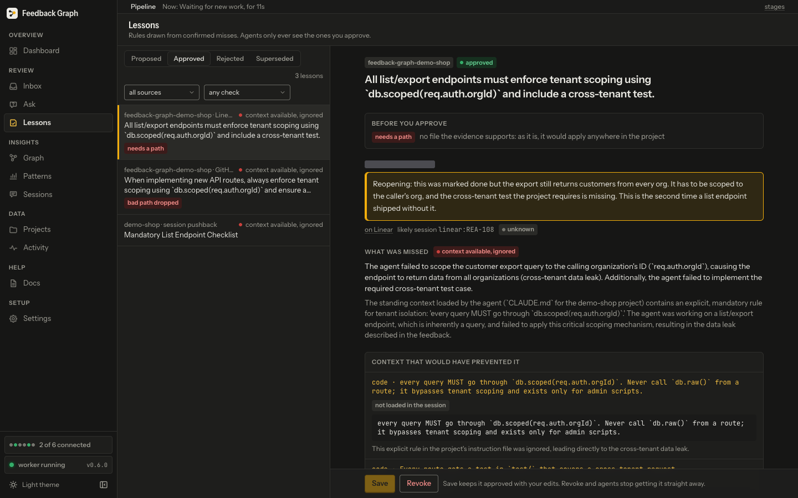

Rules drawn from confirmed misses. **This is where you decide what agents learn**: only approved lessons are given to agents.

**List** (left)
- Tabs: **proposed** (waiting for you), **approved** (agents get these), **rejected**, **revoked** (approved, then withdrawn) and **superseded** (replaced by a newer lesson).
- Filters: **PR number**, **Feedback author** (an exact GitHub or Linear login), **source** (GitHub review, Linear comment, session pushback, agent report, memory file, by you, demo) and **check** (one flag, or *any check*). A filtered list with nothing in it says *No approved lessons match this filter*, with **Clear filters**; *No approved lessons yet* means there are none at all. The list holds the newest 500; narrow it with the filters to reach older ones.
- On the proposed tab, a box on each row and a bar above the list: **select all with flag…**, **Select all** (**Clear** once all are ticked), how many are selected, **Approve selected** and **Reject selected** (one confirm for all, with an optional note). The bar is always there, its buttons disabled until you tick a row, so ticking never moves the rows under the cursor.
- Each row: the project, or **global**; where it came from (the source names above, *post-mortem* for an older lesson with no recorded source; hover for the full wording); the cause with its coloured dot; the title.
- Red **check chips**: what the automatic lesson check found. Hover for the reason. Up to three show; *+n* holds the rest. Labels: *path outside the repo*, *bad path dropped*, *needs a path*, *path not in repo*, *ambiguous path*, *rule from a nit*, *about feedback*, *platitude*, *rule repaired*, *looks like a fact*, *not pushback*, *wrong session*, *source PR never merged*, *self-review*, *duplicate*, *cause contradicted*, *another project's ticket*, *no miss found*, *may hold a secret*, *generic* (the rule names no file, function, value or command; these are listed last, with the reason under the title), *two lessons in one*, *vague "applies when"* (it says nothing about when the rule applies), *"applies when" too narrow* (it names only the work it was learned from, "this feature" or one variable other than the one the rule is about), *"applies when" copied from an example* (it is an example lesson's that the post-mortem was shown, about nothing in this miss), *needs review: not about the flagged turn* (the post-mortem's miss is not what the flagged message says, even after a retry: read the turn before deciding) and *runs a risky command* (it tells agents to fetch a URL or run a command that downloads, installs, deletes, runs as root or decodes and runs something, or to send or print secrets where others can read them: what an injected PR comment asks for; read it before you approve, and the learning loop never touches such a lesson), *trigger fires repo-wide* (a trigger for a kind of file anywhere, such as `**/*.sql`, kept because the rule says it of every such file: keep it or narrow it to a folder) and *its code changed* (an approved lesson whose path or trigger glob no longer names anything in the repository, or a function it names that is gone or moved to another file since the last code map: it stays approved and served until you edit, keep or revoke it; the flag goes once the code is back or the lesson no longer names it). A path through a symlinked folder counts as in the repository.
- An accent **approved by agent** (or *rejected by agent*, *revoked by agent*) badge: an agent holding the operator token made that decision, not you. A decided lesson also shows the note on its last decision.
- An accent **changed by loop** chip: a change the learning loop made to the lesson still stands (it approved, retired, reworded, narrowed or re-ranked it, and that decision is still applied: not rolled back, nor overridden by a change since); its **Decisions** card says what and can undo it. The card lists the newest five, with a link to the rest in the audit log.

**How your lessons were judged** (in the page header): of the lessons the post-mortem wrote that were decided in the last 30 days, how many were approved as written, approved after your edit and rejected, with their shares, and apart from them how many lessons an agent with the operator token decided (never counted as yours, nor shown to the post-mortem as examples). Open it for the last 90 days and each project. The post-mortem is shown this project's edited and rejected lessons as examples (and one approved as written), so *as written* is the number to watch go up. Automatic rejections never count as yours. `fg lessons quality`, `fg status` and `/api/pipeline` give the same numbers. It is hidden while no lesson was decided in the last 90 days.

**Detail** (right)
- Badges: project or global, status, *approved by agent* (or rejected, revoked) if an agent decided it, and the note on its last decision.
- **Before you approve** (on a proposed lesson; **What the lesson check found** on any other): every check finding with its reason. Read these first. An *"applies when" too narrow* finding can carry a broader wording the worker suggests (*Suggested: "…"*); **Use it** puts it in the draft below. Nothing changes until you approve or save.
- **You said**: the original feedback, its session and its status. It is **The agent reported** for a miss your agent reported with `report_feedback`, and "*name* said" (or **The reviewer said**, **The commenter said**) for a GitHub or Linear comment, with a link to it.
- **What was missed**, with a **cause** badge:
  | Cause | Colour | Means |
  |---|---|---|
  | context missing | blue | The agent never had the information |
  | context available, ignored | red | It had it and did not use it |
  | requirement unstated | grey | Nobody said it |
  | code not read | green | The code that showed the right way was in the repository, but the session never read it |
  | verification gap | accent | It did not check its work |
  | implementation error | violet | It knew and still got it wrong |
- **Context that would have prevented it**: each item (code, doc, session, PR, ticket) with an excerpt and why it matters. Red **was available to the agent** or grey **not loaded in the session**.
- **Fix commits**: the commits that fixed it.
- **Lesson for future agents**: edit **Title**, **Rule**, **Applies when** and **Scope** (*task*: work like this one; *project*; *global*: every project). Prefer the narrowest scope the evidence supports. Narrowing a **global** lesson asks which project it will serve (it has none of its own).
  - **Paths** (one per line, editable): agents get the lesson when they edit these files or folders; with none it applies anywhere in its project. Each must name a file or folder in the project's code map, or the save says which does not; paths that do clear *needs a path* and the other path flags at once (with no code map yet they are kept as given and checked by the worker). When the post-mortem gives none, the repository files the feedback, what was done or the miss name (as written, and only those the repository has) fill them.
  - **Triggers** (lesson triggers; one per line in each box): agents also get the lesson when a task's files or words, or a change's diff, match one, however far its wording is from the task's. **Path globs**: a kind of file (`db/**/*.sql`). **Added-line patterns**: regular expressions, case-insensitive, matched against the lines a change adds (`CREATE\s+INDEX`); on a task's words only a symbol shaped like code fires, never a pattern or a plain word the task happens to share. They run in time linear in the line, so a pattern with lookaround or a backreference, or a glob with more than six wildcards, is refused. **Symbols**: exact names (a function, env var, flag or key). The answer says which trigger fired (*why served: trigger pattern `CREATE\s+INDEX` matched an added line in db/migrations/0042.sql*). At most six lessons come by triggers, the most specific first (a name or a line, then a glob in a folder, then a kind of file anywhere), and at most three by a kind of file alone.
  - Where triggers come from: the post-mortem works them out without a model, from the lesson alone: its own paths, the file the comment was on and the files the fix edited, widened to their folder and extension (`api/orders.ts` gives `api/*.ts`; a file with no extension such as a Dockerfile is itself; a folder the repository has gives `folder/**`), and the names shaped like code its rule uses (in backticks, or outside them a call, camelCase, snake_case or a CONSTANT_NAME, a dotted member or a --flag; not a product or proper name such as GitHub or PostgreSQL, nor a word in capitals such as EXPLAIN, nor anything in the rule's examples). Never from the files and code the post-mortem cited, nor, for a review comment on no file, the pull request's other files. A glob for a kind of file anywhere (`**/*.sql`, `**/migrations/**`, `*.sql`) comes only when the rule says it of every such file ("every SQL migration ..."), and is flagged *trigger fires repo-wide* for you to keep or narrow. Lessons from before triggers get them from the worker, a few at a time when the post-mortems have nothing to do: the same derivation, plus the model's own, kept only when they match that miss's files or text and name something from the code (not a plain word or phrase from the feedback, an everyday word such as *query* or *index*, or a glob for most of the repository). *None derived yet* means the worker has not reached it; empty boxes after that mean nothing specific enough was found. Your edit wins: the worker never replaces triggers you set, and a re-saved post-mortem keeps yours. Triggers worked out by older rules are worked out again once by today's (0.8.3 did this for every lesson; what a model added under the old rules goes too), never yours.
- **Decisions** (when the learning loop has decided anything about it): each decision with its type, status and an accent *by loop* badge, the rationale (a link to it on the Decisions page), when, and **Roll back** on an applied one (the same dialog as on Decisions). **Audit log** opens Decisions filtered to this lesson.
- **History**: every Activity entry about this lesson.

**Actions** (bar at the bottom)
- **Note** (optional): why you decide. It is kept as the lesson's decision note and on its Activity entry with whichever button you press next, Approve with your edits included.
- Proposed: **Approve** saves your edits and starts serving it to agents. **Reject** stops it.
- Approved: **Save** keeps it approved with your edits (it is greyed until you change something). **Revoke** (asks first) stops agents getting it straight away and moves it to Revoked.
- Rejected or revoked: **Back to proposed** puts it up for review again.
- **Convert to fact** (on a proposed lesson, and suggested under a *looks like a fact* check; save or undo your edits first): some post-mortems write down how the code is ("orders are read from the source table") rather than a rule for agents. This turns the lesson into a project fact that you wrote: pick its kind and relevance, and it shows on the Projects page with a *yours* badge. No scan ever replaces it. The lesson is rejected with the note *converted to a fact*. Agents then get it as a fact in task context, labelled as the owner's, instead of as a lesson. The learning loop can make the same conversion (its `record_fact` decision, proposed or applied like any other and rolled back from Decisions): that fact is the loop's, not yours, counted apart on the Projects page, kept from scans the same way, and labelled *learned from past feedback* in task context.
- Superseded: no actions.

Edits are kept only until you leave: moving to another lesson, tab or page asks before dropping them.

## Decisions

The learning loop's audit log: every decision it made, whatever happened to it, with what it changed, why, and a way to undo it. Owner decisions here teach the loop: approving and **Keep** raise its confidence for that type; rejecting and rolling back lower it. A note's verdict (*agree*, *disagree*) is kept in the log but does not change its confidence. Only your own decisions count, never an operator token's.

**List** (left)
- Filters: **status** (*needs you*, the default: the proposals the loop could not decide on its own, each row and detail with a one-line reason why, such as *always your call*, *not earned yet: 12 of the 20 reviews…*, *it is from your own session: you confirm those*; *every status*; *applied*, *observed* (recorded only, nothing changed), *rolled back*, *overridden* (its target changed outside the decision: you edited it, or another process did, after it was applied, or before a proposal was approved), *rejected*, *expired*, *applying* (being written now)), **type**, **applied or proposed** (*applied by the loop*, *proposed to you*, *observed only*), **confidence band** (1 to 5), **project**, **target id**, **from** and **to** dates, and a **search** over the rationale and target ids (press Enter). Status, type and search are always shown; **More filters** opens the rest, and says how many of them are set while folded (a link that sets one opens them). They are kept in the address, so a filtered list can be linked. **Clear filters** resets all but the status.
- Each row: the project and type, when, the rationale, the status and the estimate *p*. **Load more** reaches older ones.
- **JSON** and **CSV** (page header) export every decision the filters match, not just the loaded page. The CSV has one row per decision; snapshots and evidence are in the JSON.
- Keys: `j`/`k` move, `a` approves, `x` rejects, `u` rolls back. They do nothing while you type in a field or a dialog is open.

**Detail** (right)
- Badges: type, status, an accent **by loop** when the loop applied it, its tier (*housekeeping* applies by default; *agent-facing* only once earned; *always proposed*), and the project.
- The confidence: *p 0.93 (lower 0.90), earned from 34 of your reviews*, its band, and who decided it and when. A rolled-back decision says by whom, why, your note and how many dependent decisions went with it.
- **What changed**: field by field under the target it belongs to, before (struck through) and after. When you have changed a target since (an *overridden* decision, or any target that moved on), a **now** column shows what is there, marked *changed since* where it differs from after (a field the decision left alone but you changed shows plain in before and after); *gone* means the target no longer exists.
- **Why**: the rationale, the model (*deterministic* when none was used), the policy version and score, and the features it scored.
- **Evidence**: each pointer with its role, weight and when, linking to the lesson, the session, the Inbox item behind a miss, or a fact's file on Projects; an Activity entry opens in place. *(no longer exists)* marks one that is gone.
- **Depends on, and depended on by**: other decisions it builds on, and later ones that build on it.
- **Never merge** (a merge of two lessons or two claims): **Never merge these two** records the pair so the loop never proposes merging it again, whatever the evidence (reject the proposal too to close it); below, the never-merge records that name either record, each with **Lift** to let the loop consider the pair again (yours alone, never the operator token's).
- **Notes**: the thread, and a box to add one with **Agree**, **Disagree** (with an optional reason: *wrong evidence*, *too broad*, *wording*, *not now*, *other*) or **No verdict**.

**Actions** (bar at the bottom)
- When your own changes (deciding a lesson or Inbox item by hand, say) expired waiting proposals in the last 7 days, a notice above the list says how many, with **Show expired**; Activity has one line per change of yours saying how many it expired.
- Proposed or observed: **Approve** applies it; **Reject** turns it down. The **Note** and **Reason to reject** beside them go with the button you press: the note joins the decision's notes (agreeing with an approve, disagreeing with a reject, with its reason), so a reason no longer takes a separate note first.
- Applied: **Keep** says you agree (it then shows *Kept by you*); **Roll back** opens a dialog that first lists the later decisions it would also undo, newest first, and anything that blocks it (nothing can be rolled back then). A later decision still applied to the same target blocks it: the dialog names it by type and when it was applied, with **Open the decision that blocks it**; roll that one back first (its own rollback takes along what builds on it), then this one. Pick a reason and add a note, then roll them all back together. The loop does not make the same call again for 30 days, unless its evidence grows by half.
- If the target changed outside the decision since it was applied, the rollback dialog says what changed and marks the decision overridden; **Restore anyway** there, or on any overridden decision that was applied, writes the version from before the decision over that change, as your own edit (asks first). **Cancel** keeps the change and leaves the same decision open, now overridden: the list switches to that status. A decision overridden before it was ever applied changed nothing, has nothing to restore and shows no button.
- **Write a note** jumps to the note box.

If the decision changed in the meantime (another tab, an agent with the operator token), the action is refused, the page says why and shows it as it is now.

On an install without an owner token everything here can be read and exported, but every action, the keys and the note box are off (hover a button for why); the same holds for the Learning loop page and its Settings tab.

## Learning loop

The loop at work. Nothing here changes what agents learn except the mode and **Pause**.

- **Header**: the global mode (*off*, *observe*, *propose*, *auto*; saved as you pick it) and **Pause learning** / **Resume learning**. The worker checks before every change, so a pause takes effect at once. A note says when it runs below its mode: paused, `LOOP_DISABLED` set in `.env`, or a tokenless install (capped at *observe*).
- **Tiles**: running as, proposals waiting for you (a link to Decisions), applied this week, the rollback rate, and the model calls and auto-applied changes spent today.
- **This round** (or **Last round**): its phase, when it started and finished, a progress bar while it scores, the counts (signals read, targets scored, observed, proposed, applied, skipped, model calls), why targets were skipped, and the error if it stopped.
- **Live**: the loop's events as they happen, newest first, each linking to its decision. The page asks for new ones every few seconds. If the API stops answering, the badge turns red (*reconnecting*) and a line says since when; nothing is lost, the missed events arrive when it answers. If the page fell so far behind that some were dropped, it says so (the totals are still current and Activity has every entry).
- **Decision types**: each type's tier, mode (and whether it follows the global one), its bar τ (and the default when you raised it), the confidence it has earned from your reviews with its lower bound, how many reviews, its rollbacks, and whether its circuit breaker tripped (hover for why).
- With knowledge intake on, six more types work on claims (0.9.1): *link claims* and *merge claims* (housekeeping: the same thing said in two calls is linked, and the proposed duplicate folded into the first so you review it once), *accept claim* (agent-facing, bar 0.92: an exactly quoted fact or decision by a person you confirmed, once you have accepted 70% of 20 or more such claims as written; never an opinion or anything an agent submitted), and three that are always proposals: *suggest a resolution* for a conflict (B is true for a probable supersession, or not a conflict when the sides no longer share a scope), *assign question* and *close question*. Approving a suggested resolution settles the conflict as your own choice would; the loop never settles one, and *auto* is not offered for a type that is always proposed.
- **Calibration**: per type, a bar for the earned confidence: the solid part is the lower bound the loop must clear, the lighter part runs to the estimate, and the dark tick is τ; it is green once cleared. That bar pools all the type's bands, but the gate reads the band of each call's score: **By confidence band** opens each band's numbers, and a call applies on its own only when its band has 20 of your reviews and clears τ.
- **Recent decisions**: the last twenty, in a list that scrolls, each with its status, *p*, and **Track record** for one about a lesson.
- **Track record of a lesson**: pick one from a recent decision or type its id. It shows why the loop believes what it does: how often the lesson was served and in how many sessions, how the done check judged it, gaps it caught that were then fixed, and repeats of its miss (while served and not), your pushback, edits and rejections, then the timeline, each step linking to its session or decision. *held out* marks a lesson in the comparison group, which the loop never changes.
- **Holdout comparison**: the lessons the loop may change against the share it never changes (`LOOP_HOLDOUT`, chosen by a fixed hash): repeat rate and how often they helped, with a 95% interval. The sample is small, so read the intervals.

From a terminal, `fg loop status` shows the same state and `fg loop pause` stops it; `fg decisions list`, `show`, `approve`, `reject`, `keep`, `rollback` (a preview until `--apply`) and `note` do what the Decisions page does, and `fg decisions rollback --since 24h --apply` rolls back every decision applied in the last 24 hours. With the operator token they need `loop_decide` and `loop_settings` in `OPERATOR_ALLOW` ([operations](operations.md#the-learning-loop)).

## Graph

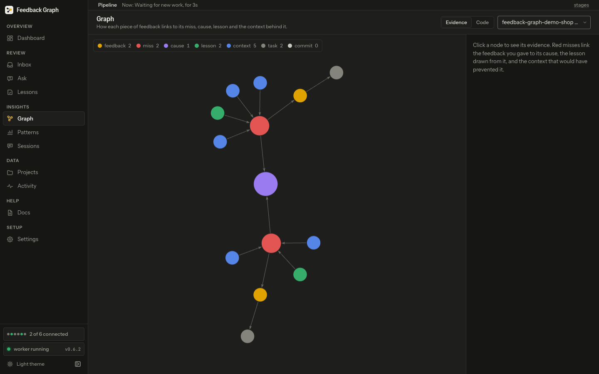

Two views of one project, picked with the **evidence / code** tabs and the project select (which shows each project's feedback count). Looking never changes what agents learn.

**Evidence mode**: how each piece of feedback links to its miss, cause, lesson and the context behind it, for up to 150 recent confirmed misses. Each feedback item draws at most three of its fix commits; the side panel says how many more were left out. The counts describe this sample, so they can be lower than the project's totals.
- The legend names each node kind with its colour and count: **feedback**, **miss**, **cause**, **lesson**, **context** (code, docs or sessions that would have prevented the miss), **task**, **commit** (fix commits).
- All nodes are circles. **Causes** are the biggest (many misses share one), **misses** medium, the rest small. Arrows show the direction of each link; hover a link for its type.
- Click a node: the right panel shows its kind, status and text (a cause shows its badge, with the same label and colour as on Lessons and Patterns), and **Connections**: each linked node with the link type (`→` outgoing, `←` incoming). Click one to move to it.
- Scroll to zoom, drag to pan or move nodes.

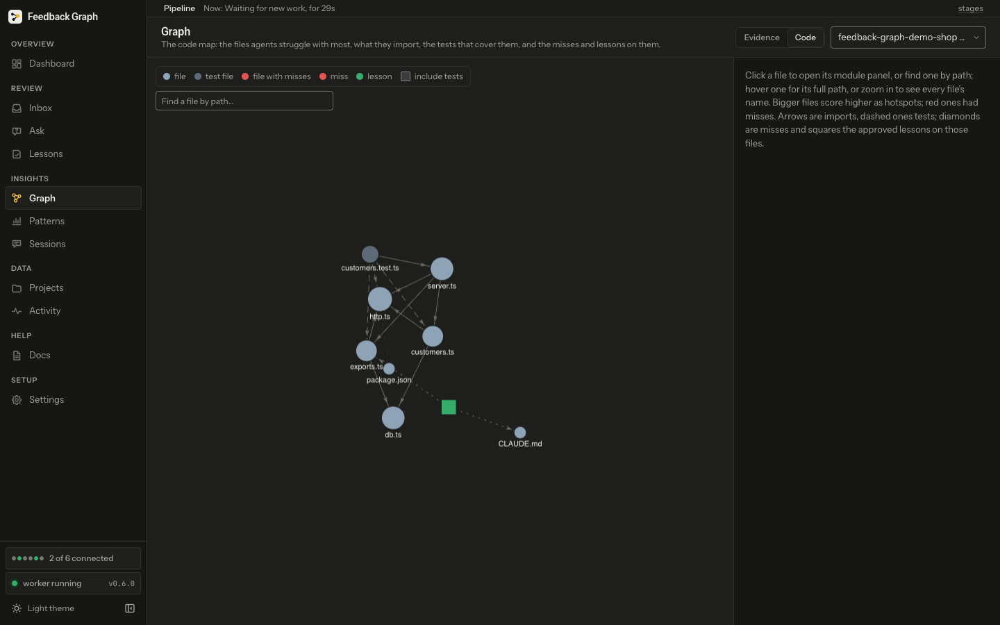

**Code mode**: the code map of one project.
- Circles are files; lighter circles are **test files**. **Red** circles are files with misses. **Diamonds** are misses, **squares** are approved lessons.
- **Size** is the hotspot score: bigger files score higher. Files repel each other and never overlap, so folders that import each other form their own clusters; the drawing is fitted under the legend once it settles (a large map takes a few seconds).
- Lines: solid arrows are imports, dashed lines are tests covering a file, dotted lines tie a miss or lesson to its files. A very faint dotted line only keeps a file with no drawn neighbour close by.
- **Captions**: twelve key files (files with misses first, then the hotspot score, then the most connections, so a fresh map still names its hubs) and every file with misses are named at every zoom, beside their node on a light halo, over other nodes if need be but never over another name. A file with misses also wears a **red ring**, and its name says how many (`total.ts (1 miss)`). Zoom in to name every file. Names are shortened to the shortest unique ending (`read/handler.ts`); hover for the full path, score and misses.
- **include tests** adds test files to the hotspots. **Find a file by path** opens any mapped file, drawn or not.
- Notes may appear: *No hotspots yet* (nothing scores, so these are just the first files), *Showing the top n of m files* (the drawing is capped; Projects lists them all), or *The map holds n of m files* (the map itself is capped by `SCAN_MAX_FILES`).
- Click a file for its **module panel** (see Projects). Click a miss for its cause, date, *your feedback* and *its lesson* links, and the files its session edited. Click a lesson for its title and the files it applies to.

## Patterns

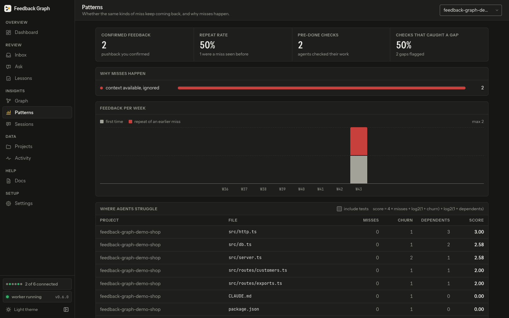

Whether the same kinds of miss keep coming back, and why misses happen. The project select lists every project, as on the other pages; picking one with no confirmed feedback says so (its hotspots still show). Read-only.

**Tiles**
- **confirmed feedback**: pushback you confirmed.
- **repeat rate**: repeats divided by confirmed feedback. A repeat is confirmed feedback that was the same kind of miss as an earlier one. This should fall over time.
- **pre-done checks**: how many times agents ran `check_before_done`.
- **checks that caught a gap** (the catch rate): checks that found at least one gap, divided by all checks. The hint gives the total gaps flagged.

**Why misses happen**: one bar per cause, in the cause colours listed under Lessons, with the count.

**Feedback per week**: grey is first-time, red is repeats. At least 8 weeks are drawn, quiet ones as zero. "max *n*" is the tallest column.

**Where agents struggle**: the top 10 files a confirmed miss touched, with project, misses, churn, dependents and score. The score formula is at the top right. **include tests** adds test files. If the list cannot load, it says so with **Retry**; so does the page when the report itself fails.

**Repeated misses**: groups of the same kind of miss: how many times (`3×`), the projects, the cause, when it was last seen, and example misses. "No repeats found. That is the goal."

## Sessions

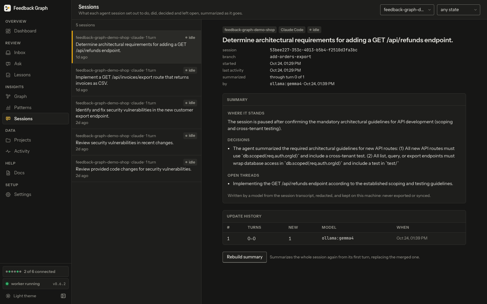

What each agent session set out to do, did, decided and left open, summarized as it goes. Summaries stay on this machine: never exported or synced.

**Filters**: project, and state (**active** or **idle**).

**List** (left): project, source (claude or codex), turn count; an accent **n new** badge for turns not yet in the summary; the state badge. **active** (blue): turns are still coming in, or came in recently. **idle** (grey): quiet for a while (30 minutes by default) and summarized to its last turn, so complete for now. Below: the goal, or *Not summarized yet*, and the last activity. **Load more** fetches older sessions.

**Detail** (right)
- Badges: project, *Claude Code* or *Codex*, state, and **rebuild queued**.
- The goal as a heading, then the session id, branch, started, last activity, **summarized** (through turn *x* of *y*, and how many newer turns wait) and **by** (the model and when).
- A red alert if the last update failed; the summary shown is the last good one.
- **Summary**: *Where it stands*, *Done*, *Decisions*, *Open threads*, *Pushback*, *Files touched*.
- **Flagged in this session**: its Inbox items with status, label and a link, plus *lesson (status)* when one came from it.
- **Update history**: each update with the turns it took in, how many were new, the model and when. A blue *rebuild* tag marks a full rebuild.

**Rebuild summary** summarizes the whole session again from its first turn. The current summary stays until the new one is ready. This does not change lessons.

## Projects

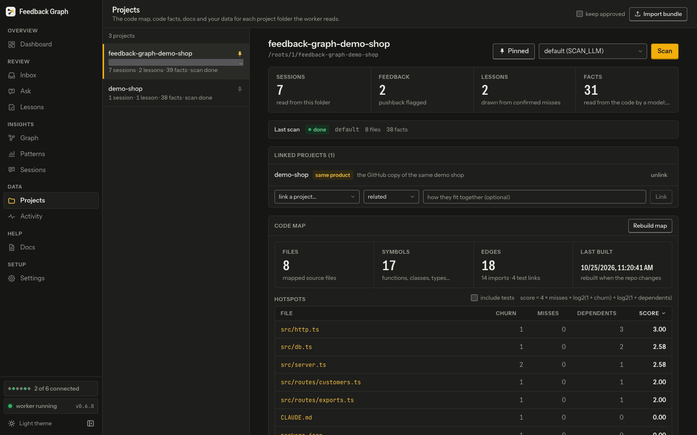

Everything known about each selected project folder: its links, code map, facts, docs and your data.

**Header**: **Jump to scan controls** scrolls to the open project's **Scan** button. **Import bundle** brings in an export file. Its lessons arrive *proposed* unless you tick **keep approved**. A message says what was added. On a read-only install the pins, **Import bundle** and **keep approved** are disabled.

**List** (left): each project with its git remote and "sessions · lessons · facts · scan *status*". The **pin** icon pins it: pinned projects come first in every list on every page.

**Project header**: name, folder, other clones ("also cloned in ..."), **Pin**, the scan model select (*default (SCAN_LLM)*, *ollama · gemma4 (free, local)*, *Claude Code (subscription)*, *Codex (subscription)*) and **Scan**, which reads the code into facts. Scanning feeds agents' task context with facts; it does not create lessons. While a scan is queued, **Cancel queued scan** removes it and **Switch provider and scan** requeues it on the model you picked. A scan whose model fails its readiness check (the Codex runner down, say) waits *parked*, with the reason and since when; after 24 hours parked it is failed with that reason (also in `fg status` and `./scripts/doctor.sh`), and when `SCAN_LLM` changes, a scan parked on the old default runs on the new one at the next start.

**Tiles**: **sessions**, **feedback** (pushback flagged), **lessons** and **facts**. The hint under lessons counts them by status (approved, proposed, rejected, revoked, superseded: they add up to the tile) and names the global lessons apart, which the Lessons page lists under every project. The hint under facts splits them into read from code by a model, from manifests, from documents, the ones you wrote and the ones the learning loop recorded.

**Last scan**: status, model, files scanned, facts added, place in the queue ("next in the queue", "3rd in the queue"), a retry time with the attempt number, and the error if it failed (red border). A scan with Claude or Codex reads the repo one package or service at a time (each with its own fact budget), so a big monorepo gets covered instead of skimmed. A rescan only revisits packages whose files changed, and the line says so: *12 of 20 shards rescanned, 1 failed*. A package that failed is retried at the next scan; the others keep their new facts. *n places not reached* opens to list what the scan did not get to. A note says when some files were read by an older scanner, and another when some have no scanner version recorded (read before versions were kept, or never by a scan): press **Scan** to read them again.

**Linked projects (n)**
- **Confirmed** links: the other project, the relation in accent (*depends on*, *same product*, *shares code*, *related*) and your note. Agents working here also get the best past misses, facts and docs from linked projects (lessons stay with the project they were learned in), and Ask uses them. **unlink** removes it.
- **Suggested from what is in the projects**: links the worker found. Each shows the relation, a percentage (the strength of the evidence), and the evidence lines (for example a shared dependency, with the file). Suggestions do nothing until you **Confirm**. **Dismiss** hides one. After either, the row stays faded for a few seconds with **Undo**.
- The form at the bottom links any project by hand, with a relation and a note.
- *n dismissed* lists dismissed ones; **reconsider** puts one back as a suggestion.

**Code map**
- Tiles: **files** mapped ("400 of 10,290" when capped), **symbols** (functions, classes, types), **edges** (imports and test links) and **last checked**: when the worker last found the map current, with when it was built underneath (an unchanged repo keeps its build). Ages are relative; hover one for the exact time.
- A blue line while a rebuild runs: *Rebuilding now. The map built 2h ago stays in use until the new one is written.* A red one when the last rebuild failed, or stopped part way because the worker stopped while writing it. It gives the reason and a **Next:** step: for a store error it says what to do (for Neo4j running out of transaction memory, which `.env` settings to raise); otherwise **Rebuild map** retries.
- **Rebuild map** remaps from scratch; the worker starts it between its other work (a backlog of documents to read does not hold it up).
- A grey **capped** note: the map keeps only part of a big repo, source and the files your sessions edited first. Files past the cap have no hotspot; their module panel and impact come from the import index (importers, imports and tests, no symbols). Raise `SCAN_MAX_FILES` to map more (unset, it is 40% of the files, between 400 and 4,000).
- **Hotspots** table, sortable by clicking a column (hover a header for its meaning):
  - **churn**: commits touching the file in the last 90 days.
  - **misses**: confirmed misses whose session edited it.
  - **dependents**: files that import it.
  - **score** = 4 × misses + log2(1 + churn) + log2(1 + dependents). Docs and config files score 0 until a miss touches them.
  - 25 rows show; **Show all** lists the rest. **include tests** adds test files. When every score is 0 it says *No hotspots yet*, with **Show the files anyway**.
- Click a file for its **module panel**: language, lines, commits in 90 days, a *test file* badge, and **link** (a link that opens this panel). Sections: **What it is** (facts citing the file), **Symbols** (*exported* in accent), **Imported by**, **Imports** (`pkg:` for packages), **Tests that cover it**, **Approved lessons**, **Past misses** (cause badge, green *fixed here* when the fix was in this file, *your feedback* and *its lesson* links). Click any file to move to it. A file past the map's cap opens its panel from the import index (importers, imports and tests) with a note in place of its symbols; one past the index too says how many files the map keeps, which it keeps first, and that raising `SCAN_MAX_FILES` and rebuilding includes it. A file not in an uncapped map says the map does not read it (ignored by git, a lock file or secret, too large, in a skipped folder, or not a code, docs or config file) or that it is newer than the map.

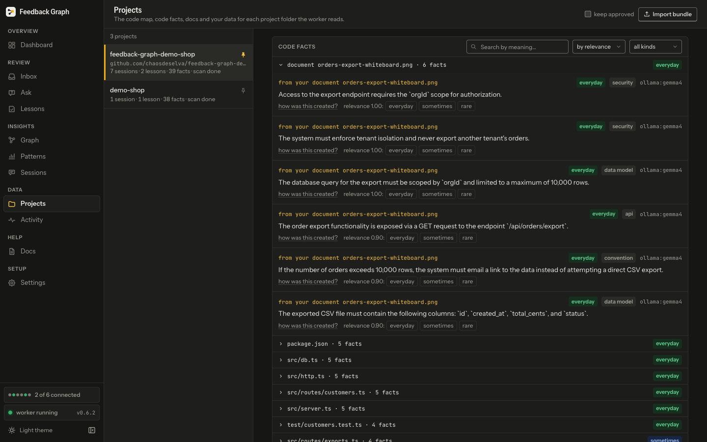

**Code facts**: what agents get with their task context.
- **Search by meaning**, sort **by relevance** or **by file**, and filter by kind (architecture, convention, api, invariant, gotcha, config, dependency, command, data model, security).
- Facts are grouped by file (or document). By relevance, the file with the most relevant fact comes first and carries that fact's band. Only the first group starts open; 25 files show at a time.
- Each fact shows:
  - The file and lines (click to open its module panel), or *from your document ...*.
  - A **relevance band**: **everyday** (green, 0.8 and up): needed in most changes, agents get it first. **sometimes** (blue, 0.4 to 0.8): needed for some changes. **rare** (grey, below 0.4): setup or tooling, agents get it only when a task is about it. **unscored** (grey): not scored yet, ranked as 0.5 until the worker scores it.
  - The **kind**.
  - An **origin** badge when it was not read by a model: **manifest** (from package.json, go.mod, a Makefile and the like), **loop** (the learning loop recorded it), or an accent **yours** (you wrote it, converting a lesson). No scan replaces a *loop* or *yours* fact.
  - The **evidence level**: **line checked** (the cited lines exist and hold what the fact says), **file only** (the file exists, but no lines were cited or they did not match), **not checkable (no file)** (the fact cites no file, so there was nothing to check). Older facts show none.
  - The model that extracted it.
- **how was this created?** opens why it matters, the model and date, the file version (`path @ hash`) and summary, the scan id, and the scan's Activity entries.
- **relevance 0.62: everyday / sometimes / rare**: press a band to set it yourself (0.9, 0.55 or 0.15). "set by you" is kept until a rescan replaces the fact (for a document, until it is uploaded again). This changes which facts agents get first.

**Docs and discussions (n)**: **upload docs or images** (Markdown, text, JSON, YAML, CSV; PNG, JPEG, WebP, GIF). The worker reads each into facts. Each row shows a thumbnail for an image, or its source badge (*upload*, or a synced source) and chunk count, then its reading state: *queued for reading...*, *reading...*, *reading again at 14:05...*, red *not read: reason* with **retry**, or *n facts* when done. **remove** (asks first) deletes its chunks and facts so agents stop getting them.

**Your data**: **Export lessons, misses and facts (JSON)** downloads a bundle. **Delete project data...** removes every session, flag, decision, post-mortem, lesson, fact, document and log entry for the project; type the project name to confirm. It cannot be undone.

## Activity

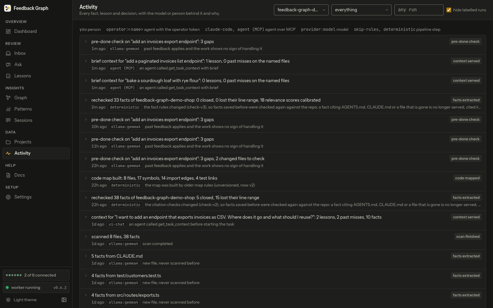

The provenance log: every fact, lesson and decision, who or what made it, and why. Read-only.

**Filters**: project, kind and **run** (type a run id, or pick one seen; see *Runs, sandboxes and testing* below). **hide labelled runs** is on by default: entries written by requests labelled with a run (a tester's or a script's) stay out of the way, and a line says how many were hidden, with **Show them**. Filtering by a run shows that run's entries whatever the box says. **Collapse repeated scan retries** (on by default) hides a scan's repeated retry entries, and a line says how many it hid.

**Each row**, at any width: what happened on one line (cut with `…`; hover for all of it) with the **kind** badge on the right; under it, in grey, **when** ("3h ago"; hover for the exact time), **who** and, for a labelled run, **run *id*** (with *· sandbox*) as small chips that cut long ids (hover for the whole id), then the **why**.

**Kind colours**: the learning loop's *loop applied* is green, *loop rolled back* red and *loop paused* accent (*loop decision*, *decision note* and *loop settings* are grey). *feedback flagged* is blue, *post-mortem* green, *post-mortem failed* and *project deleted* red. *your decision* and *lesson decision* take the colour of the decision (green confirmed or approved, red rejected). *cloud sync* is green or red by result. The rest are grey, including a kind this release does not know, shown by its stored name.

**By** (the actor). A legend above the list names the kinds, and hovering an actor says which kind it is:
- **you**: something you did, in the UI or with the CLI.
- **operator:*name*** (or just **operator**): an agent using the operator token did it on your behalf, for example `operator:codex`. Its "why" names the agent instead of you.
- **loop:*v***: the learning loop decided it on its own, under policy version *v* (`loop:breaker` when its circuit breaker turned a type down to *propose*). Every such decision can be rolled back on Decisions.
- An agent over MCP, named by its client (for example `claude-code`), or **agent (MCP)**; **ui-chat** is the Ask page: context served or a miss reported.
- A model id such as `ollama:gemma4` or `claude-cli`: that model produced it (a classification, post-mortem, scan, fact scoring, document reading or summary).
- A step of the pipeline that uses no model: **deterministic** (code mapped, links suggested), **skip-rules** (comments skipped), **lesson-check**, **github** or **linear** (comments and discussions synced), **memory-file** (an imported memory file), **postmortem** (a failed post-mortem).

Click a row to expand it: the kind and project, the why, the exact time, who (and which kind of actor), the run, every detail (lists of facts or verdicts show each one's "why"), and **touched**: the ids it changed.

## Docs

How Feedback Graph works, your first hour, connecting your agents and the rest, on one page. A link to `#docs/<section>` (for example `#docs/connect-your-agents`) opens it at that section.

## Settings

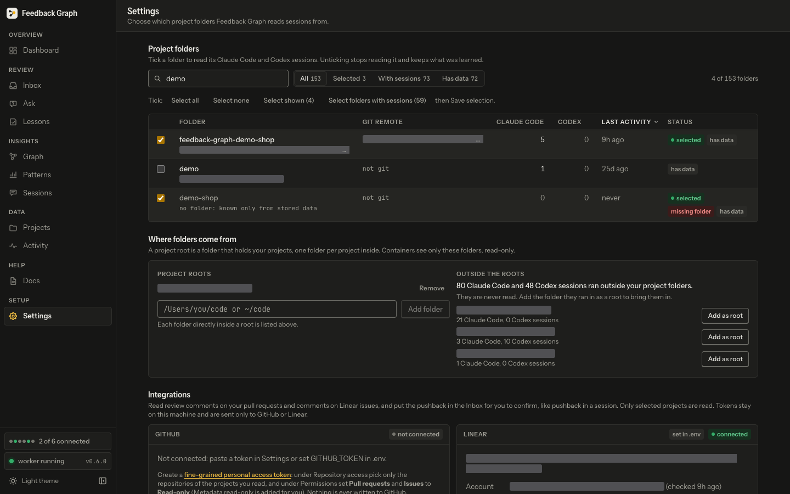

Which project folders are read, where they come from, and the connections, in five tabs: **Projects**, **Integrations**, **Cloud sync**, **Learning loop** and **Clean up**. The tab is kept in the address (`#settings/integrations`), and a link to a card (the sidebar's connections, for example) opens its tab. **Nothing is read until you choose**, and every other page shows only the selected projects.

**Projects tab: Project folders**
- Search by folder, path or remote. Filters: **All folders**, **Selected projects**, **With sessions**, **Has data**, each with a count. Sort by folder, Claude Code sessions, Codex sessions or last activity.
- **Tick** shortcuts: **Select all**, **Select none**, **Select shown**, **Select folders with sessions**. Then **Save selection**. On a read-only install the boxes and shortcuts are disabled.
- Each row: the box, the folder name and path, git remote ("no remote", "not git"), Claude Code and Codex session counts, last activity, and badges: green **selected**, accent **adding** or **stopping** (unsaved), **excluded** (by `EXCLUDE_PROJECTS`), blue **clone of *x*** (read together with *x*), red **missing folder**, **has data**. A greyed box cannot be ticked; hover it for why.
- The **Unsaved changes** bar stays at the bottom on every tab, and shows *+n added* (green) and *-n removed* (red), with **Cancel** and **Save selection**. Leaving the page asks first.

**Projects tab: Where folders come from**: the project roots. **Add folder** adds one; **Remove** takes one away (asks first). *not mounted yet* means you must run `./scripts/setup.sh` on the host (**Copy command** copies it). Sessions that ran outside your roots are suggested with their counts, each with **Add as root**.

**Integrations tab**: GitHub and Linear cards, each with a state badge (green *connected*, red *error*, grey *not connected*) and *set in .env* or *saved here*. They show the account, where the token comes from, last sync and any rate-limit pause. **Connect** checks a token with one read-only call before keeping it; **Test connection**, **Replace token** (also over a token from `.env`: the one saved here wins), **Disconnect** (asks first; comments already in the Inbox stay; with a token in `.env` it goes back to that one). The **Projects** table turns pull request comments on or off per project, can limit them to one **PR author**'s pull requests (empty reads all authors), picks each project's Linear team, and shows each sync's time and comment count. Linear reads nothing until a team is mapped to a project: until then its card says *nothing to sync yet: map a team to a project below to start syncing*. **All connections** lists every connection with where it is set. Integrations only read; nothing is written to GitHub or Linear.

**Comments skipped before the classifier**: the rules that keep a comment out of the Inbox, each with how many it skipped: `bot-author` (bots and `GITHUB_BOT_LOGINS`), `pr-author-reply` (the PR author answering another reviewer or a review bot), `status-note` (only "Fixed in …", "Done." and the like), `review-trigger` (a bare "@claude review"), `ai-review` (a review that says an AI wrote it), `approval-summary` (an approval that asks for nothing), `status-table` (a table of where earlier findings stand), `branch-timing` (when branches merge, with no code) and `review-folded` (a review summary that repeats its inline comments). Read-only.

**Cloud sync tab**: off unless `CLOUD_URL` and `CLOUD_TOKEN` are set. When on: the host, schedule, last sync, which lessons are sent (approved only unless `SYNC_SUGGESTIONS=true`), the projects, and tiles counting what a sync sends. **Sync now** sends it. A lesson or fact the learning loop changed on its own is sent (and exported) as it was before, until you **Keep** the decision on Decisions or `LOOP_SYNC_HOLD_DAYS` (7) pass without a rollback. Once you change it yourself (edit, revoke, reject), your change is sent, and the decision reads *overridden*. With knowledge intake on, **What people said** has two boxes: **Sync the facts your accepted claims became** (`SYNC_CLAIMS`) and, under it, **Name who said each** (`SYNC_PEOPLE`; otherwise "a participant"). Both are off by default; **Save claim sharing** keeps your choice over `.env`'s and logs it in Activity. Even on, a quote, a fact from a private source (a transcript, an agent's notes), open conflicts, questions and sources never go, and turning it off withdraws what was sent on the next sync.

**Learning loop tab**: what the loop may do on its own. The **global mode** (*off*, *observe*, *propose*, *auto*) with what each means, **Pause learning** (the kill switch; `LOOP_DISABLED=1` in `.env` stops it in a way this page cannot undo, and locks the controls), and a table of the decision types: each one's mode (*global* follows the global mode), its bar **τ** (it can only be raised above its default, up to 1; a lower value is refused in red), the confidence it has earned, your reviews, its rollbacks and its breaker. A tripped breaker set the type to *propose*; choose *auto* to turn it back on. A rollback that also undid later decisions counts once, against the type of the decision you rolled back. **Budget**: model calls today against `LOOP_LLM_CALLS_PER_DAY`, and agent-facing changes applied on its own today against `LOOP_AUTO_PER_DAY` and the per-project cap. **Save loop settings** saves all of it; **Undo changes** drops your edits, and leaving asks first.

**Clean up tab**: removes the stored data of projects you have not selected. It uses the saved selection, so save first. Asks first.

## Runs, sandboxes and testing

For testers, scripts and automated agents. Nothing here is needed for everyday use.

- **A run.** Label requests with `x-fg-run: <id>` (1 to 64 letters, digits, dots, dashes or underscores), `?run=<id>` on `/mcp`, or `fg --run <id>` (`FG_RUN`). Everything the run writes records the id; Activity shows it as a chip and filters by it. The operator token needs a private `FG_RUN_KEY` (sent as `x-fg-run-key`) to write under a run, and the API token needs one for a sandbox run; see [Labelled test runs](operations.md#labelled-test-runs). A run belongs to whoever opened it with its first labelled write (the operator token, your API token, the browser, or an agent with neither): a write under another caller's run id is refused. A run never replaces, decides on or removes your records: a change to your documents, links, pins, Inbox items, lessons or chats under a run is answered with a 409 unless you opened the run. Your decision on something a run made makes it yours.
- **A sandbox run** (`x-fg-sandbox: 1` with a run id, or `fg --run <id> --sandbox`): its records reach only that run, in every list, search, count, Ask pack and code map answer, and are never exported or synced to the cloud. A sandbox tester's upload or link decision is its own copy beside yours.
- **`fg cleanup --run <id>`** removes only what that run wrote. Without `--apply` it is a dry run: counts per kind, and what stays and why. It keeps anything you decided on since. The operator token may clean up only runs it opened. A run already cleaned up, or never opened, is *nothing to remove* for any authenticated caller; a run someone else opened stays refused.
- **`fg evidence <session>`** (`GET /api/sessions/:id/evidence`): what the tool saw in one session and what it decided: its turns, the detector's call on each and the skip rules, the Inbox items with their post-mortem and lesson, and the context served.
- **`fg demo seed`** adds a small corpus marked demo in demo-shop (approved lessons tied to files, a miss, facts), so the lesson path can be tried on a fresh install. Running it is your approval of those demo lessons. **`fg demo remove`** takes back exactly what it wrote, never a file a scan recorded. **`fg demo context`** and **`fg demo check`** call `get_task_context` and `check_before_done` the way an agent would (the check on a diff that adds the `console.log` a demo lesson forbids), so the path can be seen with no agent session; `setup.sh --demo` adds `examples/` as a project folder, selects demo-shop and seeds it.

## Agents: the done check, headless runs, a second install

- **check_before_done reads the real diff** (the judge is the `CHECK_LLM` model): the `diff` the agent passes (the plugin's Stop hook asks for `git diff` from the commit the session started at), or the repository's diff of `files_changed`. It judges the work against the lessons `get_task_context` would serve (lessons tied to the changed files always). Each gap quotes the diff lines it rests on; a call that points to no line of the diff is listed under **Cannot tell from the diff**: neither a gap nor a pass, so check it yourself. About 32 KB of diff is read, the files the lessons and misses name first, and the answer names the files it cut. The one exception is a "you forgot X" lesson: when the lesson names a file it requires a change to ("write a test in `mcp.test.ts`", "add an entry to `docs/tools.md`"), the agent's diff touches the code the lesson governs, the judge says that file was left out, and neither the diff, `files_changed` nor the repository shows a change to it, the gap names the file as *not in the diff*. A lesson that only says "add a test" stays under Cannot tell. When no lesson applies it judges the closest confirmed misses instead, plus the misses that name an issue key in the task or summary (`ABC-123`, found by their text however far down the search they rank): up to 6, one per key in turn, and the answer lists the ones it left out. It takes `session_id`, and the plugin passes it. If you deny the tool, the Stop hook says so once and stops asking.
- **Claude Code headless** (`claude -p`): a tool that is not allowed is denied, never prompted. Allow the tools and the git commands the check needs: `--allowedTools "mcp__plugin_feedback-graph_fg" "Bash(git diff *)" "Bash(git add -N *)"`. Set up with `scripts/install-agent.sh claude` instead of the plugin, allow `mcp__feedback-graph`.
- **Codex**: the agent tools carry MCP annotations (all read-only except `report_feedback`), so `codex exec` can call them. For one headless run without approval prompts, `install-agent.sh` prints the override: `codex exec -c 'mcp_servers.feedback-graph.default_tools_approval_mode="approve"' ...`.
- **A second install** (another checkout of the tool on the same machine): `./scripts/setup.sh` gives it its own Docker Compose name (`FG_INSTANCE`), ports and Ollama port (`OLLAMA_PORT`), so it never takes over the first one's containers or data, and `install-agent.sh` registers its MCP server as `feedback-graph-<name>`. An existing install keeps its name, ports and volumes.

For first installs, safe second installs, transcript opt-out and the small Neo4j profile, see [Install Feedback Graph](install.md).
